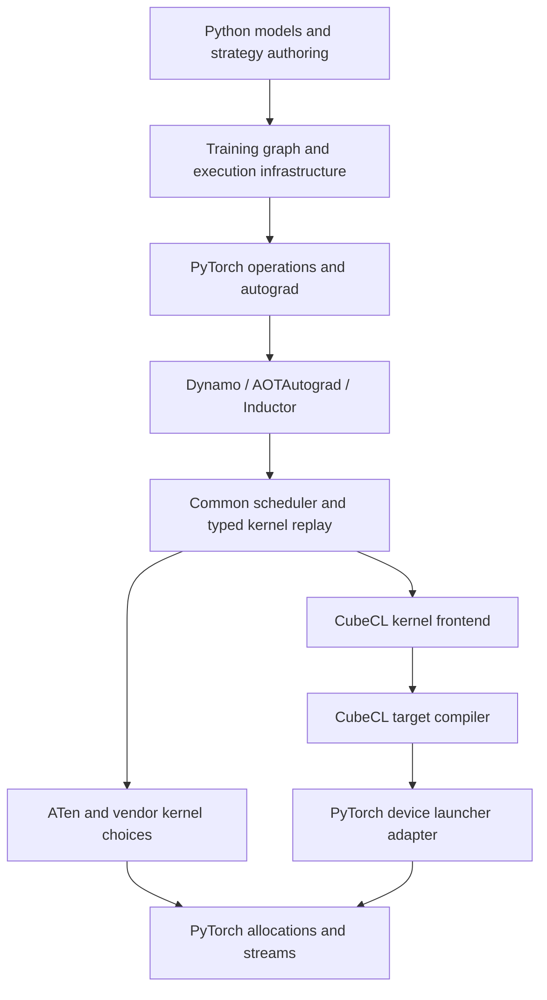

# CubeCL underneath PyTorch Inductor: source investigation and prototype design

**Research snapshot:** 12 October 2026, Europe/Budapest. Read-only investigation; no upstream or user repository was modified. Source copies were inspected, but no GPU prototype was built or benchmarked. Proposed classes, bridge functions, configuration values, and pseudocode below are explicitly design proposals, not existing interfaces.

## Executive conclusion

1. **The architecture is plausible at a concrete, existing seam.** Inductor already replays its loop-body operations into backend-specific kernels. A CubeCL backend can consume that replay while preserving Python models, Dynamo, AOTAutograd, Inductor IR, dependency analysis, and much of scheduling. It does not require Burn or Rust model authoring. The substantial new work is kernel semantics, execution mapping, the compiler bridge, launch ABI, tuning, and removing accidental Triton dependencies.
2. **Target `BaseScheduling` registration, with `CubeCLScheduling(SIMDScheduling)` and `CubeCLKernel(SIMDKernel)` for ordinary generated kernels.** Pair this with a custom Python wrapper launch path. Do not subclass `TritonKernel` merely to obtain convenient helpers. Do not target the proposed `TileKernel` hierarchy as if it already exists: the current cuTile RFC proposes it, but the inspected upstream source still directly subclasses the SIMD classes. [P-register] [P-simd] [P-triton] [I-cutile]
3. **Use CubeCL as a compiler first, with a PyTorch-facing native launcher.** On CUDA, generate CubeCL IR, compile through `CppCompiler<Cuda>` to CUDA C++, use NVRTC to obtain PTX, then load and launch it against PyTorch-owned pointers on the current PyTorch stream. Evaluate CubeCL's newer LLVM→NVPTX route alongside it. Public compiler APIs make this possible without adopting CubeCL's storage manager or compiling Rust per generated kernel. [C-cpp] [C-cuda-compiler] [C-artifact] [C-llvm]
4. **There are two different obstacles.** A known integration blocker is PyTorch's global Triton availability/import coupling, including an unconditional CUDA scheduler gate. The largest unproven engineering assumption is that a reusable mapping from Inductor's logical SIMD tiles/reduction schedules to CubeCL's threads, vectors, shared memory, and planes will preserve correctness and competitive fusion performance. A list of supported arithmetic operations cannot establish that. [P-backend] [P-cse] [P-simd] [C-scope] [C-plane]
5. **Resolve the first uncertainty with a direct, compiler-only vertical experiment before touching Inductor.** Construct a bounds-checked `sin(x)+1` kernel through `KernelBuilder`/`Scope`, compile it, inspect its complete parameter ABI, and launch it on two PyTorch tensors using a non-default stream. Include producer→kernel→consumer ordering, allocator reuse, and warmed CUDA Graph capture. Then feed the exact same bridge from Inductor operation replay. This distinguishes ABI/runtime feasibility from scheduling quality.

**Recommendation:** a small experimental PyTorch patch plus an out-of-tree bridge package for the prototype; a common kernel-description frontend with target-specific compiler/launcher adapters for the long term. Full CubeCL runtime integration is an optional platform adapter, not the initial dependency or universal architecture.

## 1. Scope, source versions, and evidence

The inspected heads were:

| Repository | Commit | What this report uses it for |
|---|---|---|
| PyTorch | `e342e9a9d7123c2b78940da0ea3fdb0dfa9beeb0` | Current Inductor classes, call paths, wrapper/runtime APIs, device hooks, alternative backends |
| CubeCL | `6bba5fdf04206d9c3710dfbc46aa9850450ab405` | Direct IR APIs, compiler passes, artifacts, storage and stream ownership |
| Triton | `9fbab754d1341f715bdd4218e480afd38af443c9` | Current native Python binding and NVIDIA launch interfaces |

All repository source links in the source index are commit-pinned. Issue/PR links describe proposals or discussion, with their status distinguished from landed source. Context7 supplied API/documentation leads; current source takes precedence when its architecture differs from documentation examples.

CubeCL's workspace currently identifies itself as version `0.11.0` and requires Rust `1.95`. **This does not mean that every inspected head API is present in a published 0.11.0 package.** Pin the commit for this experiment. In particular, the current IR is Pliron-based; an implementation using older `Instruction { operation: ... }`/`Variable` enum examples would target the wrong API. [C-workspace] [C-ir] [C-scope]

The free-threading motivation remains real in the inspected Triton binding: `libtriton` uses `NB_MODULE(libtriton, m)` without a free-threading declaration at that entry point, and issue #8491 reports CPython 3.14t re-enabling the GIL. This is evidence of a compatibility issue, not a complete audit of every Triton wheel, fork, or dependency. The bridge must independently test that importing and compiling through PyTorch does not load an incompatible native module. [T-bindings] [I-triton]

## 2. The actual PyTorch→Triton path

### 2.1 A simple graph is not necessarily two scheduler nodes

For a contiguous CUDA float32 tensor:

```python
def f(x):
    return torch.sin(x) + 1
```

Dynamo captures the Python function; AOTAutograd supplies the forward/backward graph pipeline; Inductor lowers the relevant ATen operations. `lowering.make_pointwise()` builds define-by-run `Pointwise` bodies with input loaders. A loader for an unrealized pointwise intermediate can inline its producer. Thus `sin` and `add` can already be one composite body when the final result becomes a `ComputedBuffer`. Do not assume the scheduler always receives one node for `sin` and another for `add`. [P-lowering] [P-ir]

Conceptually, its body contains:

```text
load(input, logical_offset)
sin(loaded_value)
constant(1, output_compute_dtype)
add(sin_value, one)
store(output, logical_offset, result)
```

If realization creates separate buffers, scheduler fusion can combine the corresponding nodes. Either way, backend code generation receives operation replay, not the original Python AST.

### 2.2 Source-traced call chain

The ordinary non-template CUDA path is:

```text
GraphLowering.codegen()
  → GraphLowering._update_scheduler() / Scheduler(operations)
  → Scheduler.codegen()
  → Scheduler._codegen(...)               [or graph-partition wrappers]
  → Scheduler.get_backend(device)
  → Scheduler.create_backend(device)
  → registered CUDA scheduling constructor
  → CUDACombinedScheduling.codegen_node(node)
  → TritonScheduling.codegen_node(node)   [inherited from SIMDScheduling]
  → SIMDScheduling._codegen_nodes(nodes, coalescing_analysis)
  → generate_node_schedule(nodes, numel, reduction_numel)
  → SIMDKernelFeatures(...)
  → codegen_node_schedule(features)
       → get_tiling_and_scores(...)
       → create_kernel_choices(...) → TritonKernel(...)
       → codegen_node_schedule_with_kernel(schedule, kernel)
          → with kernel
          → _codegen_node_schedule_body(...)
             → indexing collection / finalize_indexing
             → SchedulerNode.codegen(index_vars)
                → SimplifyIndexing operation handler
                → LoopBody.__call__(*index_vars)
                → LoopBodyBlock replay through V.ops
       → TritonKernel.codegen_kernel()
       → TritonScheduling.define_kernel(source, schedule, kernel)
          → _emit_kernel_to_wrapper(...)
          → wrapper.define_kernel(... async_compile.triton(...))
       → _launch_kernel_and_cleanup(...)
          → TritonKernel.call_kernel(name)
          → PythonWrapperCodegen.generate_kernel_call(... triton=True)
```

The source index links the actual entry points: [P-graph], [P-scheduler], [P-backend], [P-combined], [P-node], [P-simd-nodes], [P-simd-schedule], [P-simd-replay], [P-loop], [P-kernel-enter], [P-triton-codegen], [P-triton-define], [P-wrapper-call].

A representative generated computation body looks like this (illustrative, with metadata/imports and shape specialization omitted; this is not a captured output from running the example):

```python
@triton_heuristics.pointwise(...)  # signature, device, hints, candidate metadata
@triton.jit
def generated(in_ptr0, out_ptr0, xnumel, XBLOCK: tl.constexpr):
    xindex = tl.program_id(0) * XBLOCK + tl.arange(0, XBLOCK)
    xmask = xindex < xnumel
    value = tl.load(in_ptr0 + xindex, xmask)
    result = tl_math.sin(value) + 1.0
    tl.store(out_ptr0 + xindex, result, xmask)
```

The wrapper's `generated.run(..., stream=current_stream)` calls the autotuner/launcher object created by the decorators, not a Python interpreter evaluating this body element by element. `XBLOCK` is a logical tile extent specialized by a configuration; it is not simply the CUDA thread count. [P-triton-codegen] [P-runtime-run]

The generated module's compilation path continues:

```text
AsyncCompile.triton(kernel_name, generated_source, device_str)
  → codecache._load_triton_kernel_from_source(...)
  → PyCodeCache / reload of generated Python source
  → generated decorators produce a CachingAutotuner
  → precompile(), synchronously or in a worker
  → _precompile_worker()
  → _precompile_config(config)
     → ASTSource(fn, signature, constants, attrs)
     → GPUTarget(device_type, architecture, warp_size)
     → triton.compile(...)
  → compile results / cached artifacts
  → _make_launchers() in the execution process
  → generated wrapper obtains current raw stream
  → CachingAutotuner.run(..., stream=raw_stream)
  → selected launcher / Triton compiled kernel launch
```

Workers compile artifacts; process-local CUDA module/function loading and launcher construction must remain distinct from serializable compile results. The implementation includes multiple current launcher paths, including static launchers; it is not accurate to describe every launch as a generated C extension built afresh. [P-async-triton] [P-load-triton] [P-precompile] [P-precompile-config] [P-launchers] [P-runtime-run] [T-driver]

### 2.3 Representation and ownership at each boundary

| Stage | Input→output | Responsibility | Reuse for CubeCL |
|---|---|---|---|
| `GraphLowering` / lowering | ATen FX graph→buffers, layouts, loop bodies, extern calls | Decompositions, symbolic shape/layout semantics, realization, device information | Retain; make backend capability/fallback decisions before unsupported bodies reach codegen |
| `Scheduler` | Operation buffers and dependencies→ordered/fused scheduler nodes | Dependency legality, mutation ordering, buffer lifetimes, device/stream contexts, fusion orchestration | Retain; patch the global Triton requirement |
| `CUDACombinedScheduling` | Nodes→selected scheduling delegate | Route generated kernels versus CUDA/HIP/vendor templates | Structural precedent; existing object hard-wires Triton for ordinary nodes and is not itself the replacement |
| `SIMDScheduling` | Fused nodes→node schedule, tiling, kernel replay | Flattened groups, reduction stage ordering, common fusion/range machinery | Reuse ordinary path; override/gate advanced Triton-dependent paths |
| `SIMDKernel` | Tiling and features→range-tree/index state | Logical iteration families, index simplification, common argument/workspace state | Reuse, while implementing physical thread/vector mapping |
| `Kernel` / `CSEProxy` | Operation calls→backend values and kernel bookkeeping | Dispatch loads/stores, CSE/store forwarding, dtype/shape analysis, removed buffers | Reuse with typed CubeCL value objects and backend-neutral dtype hooks |
| `TritonKernel` | Replayed operations→Triton program | `tl` expressions, masks, pointer/descriptor accesses, reductions, physical block tensors | Replace, not merely translate the emitted source |
| `TritonScheduling.define_kernel` | Source→wrapper definition | Dedup, naming, compile requests, source/provenance metadata | Replace with CubeCL IR/artifact definition |
| `AsyncCompile` + code cache | Source→callable/future and artifacts | Compile concurrency, caches, generated-module loading | Follow the pattern, not the Triton-specific compile object contract |
| Python/C++ wrapper | Tensors, symbolic arguments→native launch | Allocate output/workspace, current device/stream, kernel sequencing | Retain general wrapper; add CubeCL-specific call emission |
| Compiler/launcher | Kernel description→device instructions and enqueue | Target lowering, module load, argument ABI, native stream launch | Rust/CubeCL compiler and native launcher |

### 2.4 Actual Triton leakage to address

**Availability gate:** `Scheduler.create_backend()` checks `has_triton()` and raises `TritonMissing` on non-MPS GPU devices. This occurs independently of which scheduler has been registered. Registering a CubeCL scheduler alone does not make a Triton-free CUDA Inductor work. [P-backend]

**Imports:** built-in backend initialization imports the Triton scheduler and combined schedulers. `runtime/hints.py` conditionally imports Triton compiler modules when the package is present; `select_algorithm.py` imports Triton template and runtime machinery. A harmless Python import of a module named `triton.py` is different from importing `triton._C.libtriton`, but the entire transitive native import path must be checked. Leaving an incompatible Triton package installed can make availability probes activate it. Removing Triton can expose new missing-package assumptions. [P-builtins] [P-hints] [P-selection] [P-triton-utils]

**Typed replay:** `CSEProxy._default()` only automatically applies dtype/shape propagation for named backends such as `triton`, `cpp`, and `mps`. `get_current_backend()` returns the configured CUDA backend name. A newly named `cubecl` backend does not automatically receive all this behavior. `upcast_compute_type()` also explicitly checks for Triton. Add hooks or a small experimental extension, and implement the intended numeric policy explicitly. [P-cse] [P-backend-name]

**SIMD does not mean completely backend-neutral:** many SIMD configuration accesses are in `config.triton`; advanced nested/staged/mixed-order reduction helpers use Triton values, layouts, or compiler metadata. Combo kernels explicitly require a `TritonKernel` subclass. Ordinary flattened pointwise replay is much more reusable than these specialized paths. [P-simd] [P-combo]

**Wrapper ABI:** `generate_kernel_call(triton=False)` does not mean “call any alternative GPU kernel object.” Its CUDA path assumes a compiled-library-style function and raw-pointer preparation. Emit a dedicated CubeCL call, as Pallas and Metal already do for their different runtime interfaces. [P-wrapper-call] [P-pallas-call] [P-metal-call]

**Templates and tuning:** `TritonTemplateKernel`, Triton benchmark requests, Triton `Config`, block-size constants, and `CachingAutotuner` carry backend-specific assumptions. Reusing selection orchestration requires a new candidate/benchmark adapter; it does not make these objects CubeCL-compatible. [P-selection] [P-hints] [P-runtime-run]

## 3. What SIMD and common Inductor infrastructure already provide

Classification: **G** = already generic and reusable; **H** = generic structure with backend hooks; **S** = currently Triton-coupled but separable; **T** = tied to Triton's present representation; **L** = later than the first pointwise prototype. Multiple labels describe different layers of the same feature.

| Concern | Class | Existing reusable part | CubeCL responsibility / restriction |
|---|---|---|---|
| Scheduler fusion | G/H | Read/write dependencies, ordering, fusion candidate formation | Backend legality and profitability; decline unsupported tile/reduction arrangements |
| Memory dependencies | G | `MemoryDep`, weak/star dependencies, mutation/alias ordering | Accurately declare accesses; preserve effects in IR; no speculative unsafe loads |
| Range construction | G/H | Flattened groups, range trees, extent splitting, SymPy simplification | Convert iteration variables into actual per-thread/per-vector coordinates |
| Loop/reduction schedule | H/S | Node schedules and reduction-enabled/disabled regions | Reduction implementation, storage of intermediate reductions, cross-stage mapping |
| Tiling | H/S | Access/coalescing analysis, split selection | Map logical tile to workgroup/plane/thread/vector sizes; replace block-size heuristics |
| Indexing | G/H | SymPy index expressions, range simplification, width analysis | Translate FloorDiv/Mod/ModularIndexing and indirect expressions with exact signed semantics |
| Masking | H | `ops.masked`, scoped load masks, logical bounds | Predicate memory operations; implement fill values and nested scopes |
| Broadcasting | G/H | Lowered index transforms and output ranges | Scalar uniformity, local vector broadcasts, reduction-result sharing |
| Dtype propagation | G/S | Shared dtype handlers, buffer dtypes, operation metadata | Extend backend recognition; storage versus compute dtype; conversions and precision barriers |
| Vectorization | H/S | Strides/alignment facts and logical tile information | Choose lane width; distinguish local vectors from workgroup-distributed tiles |
| Kernel arguments | G/H | `KernelArgs.input/output/size`, aliases/workspaces | Stable buffer/scalar order; CubeCL metadata ABI and target parameter layout |
| Loads/stores | H | Store forwarding, CSE, removed-buffer bookkeeping | Address spaces, index units, alignment, masks, alias-aware invalidation |
| Reductions | H/S/T/L | Reduction graph/domain and some fallback decomposition | Plane/shared-memory algorithms, neutral elements, Welford/arg semantics, split reductions |
| Atomics | H/L | Store mode (`atomic_add`), scatter dependency modeling | Pointer atomic type, operation/type availability, ordering, determinism behavior |
| RNG | S/L | Seed/offset plumbing and graph-level RNG state | Implement required Philox/statistical/offset semantics and checkpoint behavior |
| Dynamic/symbolic shapes | G/H | Guards, symbolic extents, scalar discovery | Runtime extent/scalar ABI; masks; widths; shape-specialization policy |
| Launch dimensions | H/S | Logical extents and device contexts | Grid/workgroup calculation; local vector width; target limits |
| Autotuning | G/S/L | Algorithm-selection orchestration and candidate costs | CubeCL compile/launch candidates, device timers, cache of selected configurations |
| Benchmarking | G/S/L | Device benchmark infrastructure, profiling, extern-candidate tests | Adapter returning comparable timings; reset mutations/RNG/output state |
| Code caching | G/S | Hashes, file locks, generated wrapper/FX caches | Canonical kernel descriptor and binary cache; no native handles in disk caches |
| Wrapper generation | G/H/S | Allocations, guards, symbolic expressions, graph sequencing | Dedicated definition/call emission; stream handling; C++/AOT support later |
| Template kernels | H/S/T/L | `KernelTemplate`, `ChoiceCaller`, template-buffer structure | CubeCL template/candidate classes; target schedules; workspace/ABI metadata |
| GEMM selection | G/S/L | ATen/external choices and selector orchestration | Keep ATen initially; add CubeCL candidates with capability gates |
| Prologue/epilogue fusion | H/T/L | Fusion legality and operation replay around templates | Expose tile coordinates/accumulators and numeric materialization boundaries |
| Foreach/combo kernels | T/L | Graph-level operation grouping | New multi-kernel packing/dispatch if useful; current combo emitter is not reusable directly |

The evidence is the ordinary two-pass replay in `SIMDScheduling`, `KernelArgs` and `CSEProxy`, plus specialized SIMD methods and `select_algorithm`. [P-simd-replay] [P-args] [P-cse] [P-dependencies] [P-selection]

**Practical implementation surface:** one scheduling class; a kernel with range, load/store, mask, cast, reduction, launch and serialization hooks; typed operation overrides; an IR-aware value/CSE layer; a compile/cache adapter; a wrapper adapter; and capability/fallback plumbing. General training adds reduction algorithms, RNG, indirect operations, tuning, templates, device-specific launchers, and integration tests. This is substantially smaller than reimplementing all Triton, but substantially larger than implementing `sin` and `add` overrides.

## 4. Integration precedents: what to copy and what not to copy

### Halide

`HalideScheduling` subclasses `SIMDScheduling` because it can reuse flattened indexing, group/schedule construction, and loop-body replay. `HalideKernel` subclasses `SIMDKernel`, supplies `HalideOverrides`, Halide expressions/functions, indexing, loads/stores, reductions/scans, argument descriptions, source generation, and launch emission. Its values track used dimensions so Halide can express the same logical computation in its own representation. [P-halide]

`HalideScheduling.define_kernel()` registers a wrapper definition calling `async_compile.halide(meta, source)`. `AsyncCompile.halide()` goes through `HalideCodeCache`. The cache generates native glue around `halide_buffer_t` objects. On CUDA it sets the buffer's device field from the supplied pointer, marks device memory dirty, and installs hooks that obtain the current CUDA context and the passed stream. Thus Halide provides a concrete precedent for **foreign PyTorch allocations and PyTorch stream execution without replacing Python models**. [P-halide-define] [P-async-halide] [P-halide-cache]

Its feature set is narrower than Triton's: tuple reductions, preferred store loop order, reduction to one element, and optional scans are declared; Triton's full foreach, indirect-indexing, scatter, sort and template feature set is not. Bounds-check/assert methods are TODO/no-op in the inspected kernel. Halide does implement RNG helpers and an atomic-add store path, so “Halide has no randomness or atomics” would be incorrect. Absence of a declared feature is not proof that its underlying compiler cannot implement it. [P-halide]

Useful template for CubeCL: scheduling subclass, typed value representation, custom definition, custom argument ABI, current-context/current-stream hooks. Do not copy Halide's buffer ABI, runtime scheduling, or TODO bounds behavior.

### Pallas

`PallasScheduling` and `PallasKernel` also inherit the SIMD classes. Operation overrides target JAX/Pallas; source registration uses `async_compile.pallas`. `PallasKernelWrapper` exposes a `.run()` interface, and `PallasKernel.call_kernel()` emits its own call rather than relying on the ordinary Triton wrapper helper. It supplies additional reduction-fusion restrictions where its keepdims representation would otherwise miscompile the fusion. [P-pallas] [P-pallas-call]

This is evidence that backend-specific fusion vetoes and dedicated runtime calls are legitimate architecture, not a failure to implement the SIMD contract. It is not a reason to introduce JAX or another tensor owner into the CubeCL bridge.

### Metal/MPS

`MetalScheduling(SIMDScheduling)` and `MetalKernel(SIMDKernel)` generate MSL. The current Python path batches emitted kernels into a Metal library through `AsyncCompile.metal`; the C++ wrapper has a separate library/source path. Metal implements different launch dimension handling and reduction code. The reduction implementation explicitly says only sum and product are reasonably optimized in that section; this should not be generalized into a claim that every other operation is absent. [P-metal] [P-metal-call]

This is the most relevant long-term Apple precedent: have CubeCL emit MSL and use the existing PyTorch MPS buffer/encoder integration, rather than creating an independent Metal command queue and assuming shared memory implies ordering.

### CPU/C++

`CppScheduling` follows `BaseScheduling` and loop-nest/SIMD-vector C++ code generation rather than using the GPU flattened SIMD scheduler identically. Its existence proves registration does not mandate a SIMD implementation. It is less useful than Halide/Metal for the initial GPU mapping. CubeCL's CPU LLVM/JIT route can be a separate adapter later; it is not needed to demonstrate CUDA integration. [P-cpp] [C-llvm]

### CUDA/XPU combined scheduling and extension tests

Current `CUDACombinedScheduling` has delegates for Triton, CUTLASS, ROCm C++, CuTeDSL, FlyDSL, and NV universal GEMM. Ordinary kernels still go to Triton. `XPUCombinedScheduling` routes between Triton and a SYCL/C++ template path. Replacing ordinary generated kernels should preserve the option of keeping vendor-library/template delegates, with their actual Python/free-threading dependencies checked individually. [P-combined] [P-xpu]

`register_backend_for_device()` registers scheduling and Python/C++/FX wrappers. Current private-device initialization also supports `_inductor_backend_init`, custom passes and configuration. `test_extension_backend.py`, `test_device_backend_hooks.py`, and the example extension backend exercise those boundaries. **A CUDA kernel alternative does not require a new PrivateUse1 tensor device.** Keep tensors on the real CUDA/ROCm/XPU/MPS device and select codegen for that device. [P-register] [P-hooks] [P-extension]

### New tile abstraction: proposal versus landed mechanism

PyTorch issue #175311 proposes `TileKernel`, `TileKernelScheduling`, and `TileTemplateMixin` for cuTile/Triton sharing. It explicitly discusses the gap between Inductor's offset-based memory IR and cuTile's array model. This is an unusually relevant design precedent. But the source inspected here still declares `TritonKernel(SIMDKernel)` and `TritonScheduling(SIMDScheduling)`; the current codegen directory has no landed `tile.py`/`cutile.py` corresponding to that RFC. [I-cutile] [P-triton] [P-builtins]

Use the existing SIMD seam now. Keep physical tile mapping in an adapter so it can migrate to a future shared tile interface. The recently present `SIMDKernel.codegen_template_body()` and kernel emission override hooks are useful extension points, but they do not establish a complete, stable, backend-neutral tile compiler interface. [P-simd] [P-triton-define]

Two reduction PRs illustrate why a pinned experimental adapter needs capability gates and upstream tracking. [PR #196660](https://github.com/pytorch/pytorch/pull/196660), open and unmerged when inspected, proposes ranked reduction results and a backend feature flag; its proposed store/stage contract must not be treated as current upstream API. [PR #182896](https://github.com/pytorch/pytorch/pull/182896), closed without merging, discusses nested-reduction legality constrained by Triton block geometry. Current source separately contains evolved nested/staged-reduction machinery, so that PR is design history, not evidence that its exact implementation landed. The relevant lesson is to extend ordinary replay incrementally while making each advanced schedule's acceptance explicit.

## 5. CubeCL beneath `#[cube]`

### 5.1 Current construction and compilation path

The macro generates Rust host-side expansion code and kernel wrappers. The generated kernel's `define()` creates a `KernelBuilder`, expands arguments/body into its `Scope`, and calls `builder.build()`. This happens at kernel definition/compilation time, not by invoking `rustc` for every new input shape. [C-macros] [C-builder]

```text
Rust #[cube] syntax
  → proc-macro-generated Rust expansion function and kernel type
  → kernel.define()
  → KernelBuilder::new(KernelSettings)
  → argument registration + Scope/Pliron operation construction
  → KernelBuilder::build()
  → KernelExpansion { scope, info }
  → KernelIntegrator::integrate(settings)
  → KernelDefinition { body: Scope, info: Info, settings }
  → Compiler::compile(definition, options)
  → target representation
  → source/binary artifact compilation as required
  → backend module load and launch
```

`KernelBuilder`, `KernelIntegrator`, `KernelDefinition`, `Scope`, dialect modules and `Compiler` are publicly accessible. `KernelDefinition` has public fields. `KernelBuilder.buffer()` registers an ordinary global buffer; `tensor()` registers extended shape/stride metadata; `scalar()` registers a scalar field by element type. `Scope` exposes global arguments, shared/local variables, operation insertion, constants and access to its Pliron context. **An external frontend can construct this IR directly.** [C-builder] [C-integrator] [C-kernel] [C-scope] [C-ir]

The lowest practical frontend entry is **`KernelBuilder` plus direct dialect operations in its `Scope`**, not raw target IR and not generated Rust source. It preserves CubeCL's normal argument/metadata construction while avoiding Rust generics/macros as the dynamic frontend language. Direct `KernelDefinition` construction is possible but makes the bridge responsible for invariants the builder already handles.

### 5.2 Compiler outputs are target-specific

| Compiler path | Current output | Additional step before native execution |
|---|---|---|
| `CppCompiler<Cuda>` | `ComputeKernel` with CUDA C++ source, shared-memory and buffer-access metadata | NVRTC→PTX, CUDA module load |
| `CudaCompiler::Llvm` / `PlironCompiler` targeting NVPTX | `NvptxModule` with NUL-terminated PTX, entrypoint, IR and shared-memory size | CUDA module load/JIT |
| HIP C++ compiler | HIP source | HIPRTC/toolchain artifact build, module load |
| LLVM AMDGPU | `AmdGpuModule` with loadable code object and entrypoint | HIP/AMDGPU module load |
| MSL compiler | Metal source/representation | Metal library and compute pipeline creation |
| SPIR-V compiler | SPIR-V kernel representation | Vulkan/WGPU shader/pipeline creation and bindings |
| WGSL compiler | WGSL compute shader | WGPU shader/pipeline compilation |
| CPU LLVM | `PlironEngine` JIT artifact | JIT invocation with the expected argument layout |

`CudaCompiler` is public. The normal CUDA runtime's `CudaArtifactCompiler` and module-loader machinery live in `pub(crate)` modules; do not design an out-of-tree package around calling those private types. For compiler-only integration, use public compiler outputs and a small independent NVRTC/driver adapter. An upstream public artifact-building API would reduce duplicate glue but is not a prerequisite. [C-cpp] [C-cuda-compiler] [C-artifact] [C-cuda-compute] [C-llvm] [C-wgpu]

### 5.3 What the compiler already does

The C++ compiler performs verification, pending-op resolution, simplification/CSE, scalar replacement, constant propagation, numeric/type legalization, memory safety lowering, builtin/metadata lowering, vector expansion/unrolling, target-op conversion, visibility/shared-memory analysis, and source emission. LLVM also uses Pliron passes for scalar replacement, constant propagation/CSE, numeric legalization, control-flow lowering, entry ABI lowering, Cube→LLVM conversion, CFG simplification, dead-code elimination and promotion of memory to registers, followed by target compilation. [C-cpp] [C-llvm]

This is a real dynamic compiler. **It is not a replacement for Inductor's graph fusion scheduler**, and it is not evidence that a thread-level kernel automatically becomes an optimal tiled reduction or GEMM. The frontend still has to express the execution algorithm.

### 5.4 IR stability and serialization

The APIs are public Rust APIs, but the inspected source does not establish a stable external compiler ABI or versioned frontend schema. Pin commits and isolate their use. The Pliron representation and current compiler refactoring are maintenance risks even if the high-level CubeCL language remains usable.

There are `serde` derives/features on element/type-related values, settings components and runtime metadata, and Pliron dialects expose parsers/printers. However, **`KernelDefinition` and its `Scope` are not a ready-made serde kernel interchange format**. A live Scope owns context-specific values/types, insertion state and auxiliary data. Printing a module does not serialize all of the builder's `Info`/settings/device state or automatically restore it. [C-kernel] [C-scope] [C-settings] [C-ir]

Preferred Python↔Rust boundary: a small versioned, typed kernel-description format owned by the bridge. Initially JSON/MessagePack/CBOR-style bytes are adequate; replace with a compact binary encoding only after measuring compile-time overhead. Include argument descriptors, SSA IDs, structured regions, dtypes, vector widths, iteration mapping, masks, reduction descriptors, and numeric policy. Rust builds the current CubeCL IR. Do not expose Pliron pointer/arena handles to Python, or assume serializing Rust enums gives a durable ABI.

### 5.5 Information required before target compilation

The description must settle storage/compute types, address width, buffer binding order, local vector widths, workgroup dimensions, shared/local memory sizes, algorithm configuration, entrypoint, execution mode, and required device features. Runtime values can include symbolic extents, strides, scalar parameters and tensor pointers. Dynamic shapes do not imply dynamic workgroup sizes or runtime-sized register vectors; compile variants where physical layouts must be static. [C-builder] [C-settings] [C-metadata]

## 6. Inductor→CubeCL translation

### 6.1 Keep logical tiles distinct from local vectors

Inductor's `XBLOCK`/reduction block tensors describe a logical set of elements distributed across a Triton program. A CubeCL `Vector<f32, 4>` is four values in a particular unit's local representation; a plane operation communicates across units. These are not interchangeable.

For the first pointwise mapping, use one scalar element per unit:

```text
logical index = workgroup_id_x * workgroup_size_x + unit_id_x
valid = logical index < N
```

For later vectorization:

```text
base = (workgroup_id_x * workgroup_size_x + unit_id_x) * V
indices = base + [0, ..., V-1]
```

Choose `V` only when storage offsets, alignment, strides and masks make vector loads/stores legal. An Inductor logical tile can instead use multiple per-unit iterations; logical tile size need not equal workgroup size. Express that mapping once in a `PhysicalKernelPlan`, separate from typed operation replay. This is a proposed bridge object.

### 6.2 Worked `sin(x)+1` replay

For the fixed contiguous float32 case:

1. Inductor produces a `SchedulerNode` with pointwise extent `N` and no reduction.
2. `SIMDScheduling` supplies a pointwise schedule and range/index expressions.
3. `CubeCLKernel` maps the flattened pointwise coordinate to the physical thread coordinate.
4. `SchedulerNode.codegen()` replays load, sin, constant, add and store.
5. CubeCL operation overrides create typed SSA records in the bridge descriptor, not strings containing `tl.*`.
6. Rust decodes the descriptor, creates `KernelBuilder`, registers buffers, creates operations in its Scope, and builds `KernelDefinition`.
7. The selected CubeCL compiler returns target source/artifact.
8. The PyTorch wrapper allocates output and launches the artifact on its current stream.

Representative **proposed Python-side pseudocode**, not an existing API:

```python
class CubeValue(CSEVariable):
    # SSA ID, storage/compute dtype, local vector shape, mask provenance
    ...

class CubeOverrides(OpOverrides):
    def sin(self, x):
        return V.kernel.ir.emit("sin", x, dtype=x.dtype)

    def add(self, a, b):
        return V.kernel.ir.emit("add", a, b, dtype=resolve_add_dtype(a, b))

class CubeCLKernel(SIMDKernel):
    overrides = CubeOverrides

    def load(self, name, index):
        argument = self.args.input(name)
        offset = self.lower_symbolic_index(index)
        return self.ir.masked_load(argument, offset, self.active_mask,
                                   dtype=V.graph.get_dtype(name))

    def store(self, name, index, value, mode=None):
        argument = self.args.output(name)
        self.ir.masked_store(argument, self.lower_symbolic_index(index),
                             value, self.active_mask, mode=mode)
        # Also update common store/CSE/removal bookkeeping.

    def codegen_kernel(self):
        return self.ir.canonical_serialize()

class CubeCLScheduling(SIMDScheduling):
    kernel_type = CubeCLKernel

    def define_kernel(self, descriptor, schedule, kernel):
        # Define a cached CubeCL compile request in the generated wrapper.
        ...
```

Use `CubeValue` as a `CSEVariable`-compatible object. `CSE.generate()` already returns an existing `CSEVariable` without emitting an assignment string, which is helpful for structured IR values. Add IR-level CSE keyed by opcode, operands, dtype, vector shape and mask scope. Extend `CSEProxy`'s backend/dtype behavior or install a dedicated compatible handler; do not let CubeCL dtypes silently become `None`. Loads/stores must retain common store forwarding and removed-buffer semantics. [P-cse] [P-kernel-enter]

Representative **Rust construction sketch** using real current API names but intentionally omitting exact constructor arguments/region plumbing:

```rust
let settings = KernelSettings::new(
    Dim3::new_1d(256), ExecutionMode::Unchecked, AddressType::U64
).kernel_name("cube_pointwise");
let mut builder = KernelBuilder::new(settings);
// Register float32 global buffers in bridge ABI order.
// builder.buffer(f32_type) gives each a Pliron Value.
// ReadBuiltinOp for Builtin::AbsolutePos, or explicit workgroup/unit arithmetic.
// Compare position to N; construct an IfOp region.
// In the region: IndexOp → LoadOp → SinOp → FAddOp → StoreOp.
let definition = builder.build();
let representation = CppCompiler::<Cuda>::default()
    .compile(definition, &compilation_options)?;
// representation.source → NVRTC → PTX → CUDA module/function.
```

`Unchecked` here means the bridge supplies explicit bounds predicates, not that bounds can be ignored. A checked mode can add backend safety machinery and metadata requirements; compare it deliberately rather than mixing modes accidentally. The actual entry argument list must be taken from the emitted kernel and compiler ABI metadata. [C-builder] [C-settings] [C-memory] [C-general] [C-math]

### 6.3 Operation mapping

| Inductor semantic operation | Current CubeCL building block | Translation obligation |
|---|---|---|
| `load(buffer, offset)` | `memory::IndexOp` then `LoadOp` | Element versus byte offset, storage dtype, alignment, actual predicate |
| `store(buffer, offset, value)` | `IndexOp` then `StoreOp` | Store dtype conversion, predicate, effect ordering, mutation |
| `constant` | Pliron `ConstantOp` with CubeCL numeric attribute/type | Preserve bit width, NaNs/signed zero, scalar promotion |
| `to_dtype` | `general::CastOp`; `ReinterpretCastOp` for bit reinterpretation | Numeric conversion versus reinterpretation; compute/storage policy |
| `add/sub/mul` | Integer or float math op families: `IAddOp`/`FAddOp`, `ISubOp`/`FSubOp`, `IMulOp`/`FMulOp` | Choose from resolved operand/result types; no implicit string-based promotion |
| true division | `FDivOp` or appropriately converted operands | Match PyTorch promotion and integer-input true-divide behavior |
| integer division/modulo | Signed/unsigned division/remainder/floor operation families | SymPy/Python floor behavior for negative operands; not interchangeable with truncation |
| `sin`, `exp` | `math::SinOp`, `ExpOp` | Math precision/approximation and low-precision upcasting policy |
| comparison | Signed, unsigned or float comparison dialect ops | Ordered/unordered NaN behavior and boolean result shape |
| `where` | `general::SelectOp` | Value selection; does not make eagerly evaluated memory loads safe |
| index arithmetic | Integer/index ops, casts and builtins | Width/overflow guarantees, broadcast transforms, symbolic parameters |
| masked computation/load/store | Structured branch (`IfOp`/SCF) and predicated accesses/fill values | Preserve lazy masked body evaluation and fill semantics |
| shared temporary | `Scope.create_shared()` / shared-address-space variables | Static allocation, alignment, barriers and bank layout |
| warp/plane collective | Plane reduction/shuffle/broadcast/ballot dialect | Active lanes, plane width, divergence legality |
| atomic update | Atomic load/store/RMW/compare-exchange families | Atomic pointer type, supported dtype/target, ordering and initialization |

See current math, comparison, general, memory, plane, atomic and structured-control-flow dialects. [C-math] [C-cmp] [C-general] [C-memory] [C-plane] [C-atomic] [C-scf]

### 6.4 Broadcasting

For `x[B,N] + bias[N]`, Inductor already represents output iteration coordinates and the bias offset. For flat coordinate `i`, contiguous inputs use `x[i]` and `bias[i % N]`. General strides use a reconstructed coordinate per dimension, with broadcast dimensions contributing zero. No expanded tensor is needed.

Difficulty appears with division/modulo cost, mixed layouts, vector alignment, broadcasted local values, and values produced by reductions. The physical plan should classify values as device/workgroup/plane/unit/local-vector uniform where possible. Do not translate `tl.broadcast_to` one-for-one into a local vector broadcast when it crosses threads.

### 6.5 Reduction

For row sum `x[B,N].sum(-1)`, initially assign one workgroup per row. Each unit accumulates a strided subset in registers, then reduce within planes and combine plane partials in shared memory. The final unit stores the row result. Inactive values contribute zero; max/min need the correct infinities and NaN policy. Accumulation dtype can differ from input/output dtype.

This requires a new reduction emitter; an Inductor `ops.reduction()` cannot be replaced by one local-vector sum when values live across units. Large/low-output-count reductions need split stages and PyTorch-owned intermediate buffers. Welford tuples, argmax tie-breaking/indexes, boolean reductions and integer overflow are separate semantic cases. CubeCL supplies plane/shared/barrier primitives; the bridge chooses their composition. [C-plane] [C-memory] [C-synchronization] [P-simd]

### 6.6 Softmax-like reduction

Emit max, subtract, exponential, sum and division within one row workgroup when the row fits a sensible register/shared-memory plan. Retain/recompute inputs or exponentials based on register pressure. A reduction-disabled pointwise stage must receive its reduced scalar on all consuming units, generally via broadcast/shared memory.

Uniform barrier placement is essential: invalid tail lanes cannot return before a workgroup barrier needed by valid lanes. Very long rows need a multipass algorithm. Compare persistent and looped variants; matching pointwise output alone does not verify reduction-stage mapping.

### 6.7 Atomic update

For scatter-add, translate Inductor's atomic store mode to a typed atomic RMW on the target pointer. Ensure initialization/zeroing occurs before the update, guard invalid indices correctly, preserve alias/mutation dependencies, and respect deterministic-algorithm requirements. FP16/BF16 atomics and vector atomics have target-specific limits. The normal CubeCL generic handle API is irrelevant when the launcher directly supplies the pointer. [P-ops] [C-atomic] [C-lowered-features]

### 6.8 GEMM and templates

Keep ATen/cuBLAS/rocBLAS/oneMKL/native MPS matmul first. General pointwise support does not require a CubeCL matmul implementation. Later add a `CubeCLTemplate`/`CubeCLChoiceCaller` (proposed names) that supplies a tiled algorithm, launch/ABI/workspace metadata and benchmark adapter. The common `KernelTemplate`/`ChoiceCaller` interfaces are useful, but Triton template source bodies are not portable kernel descriptions. [P-template] [P-selection] [P-mm]

A CubeCL GEMM must choose matrix fragments, global/shared layouts, pipeline depth, matrix-operation families and accumulator types. Epilogue replay needs a mapping from logical output indices into distributed accumulator fragments. Prologue fusion can affect load layout, masking and pipeline legality. Existing CubeCL/CubeK algorithms can be evaluated as kernel implementations, but their availability does not prove arbitrary Inductor epilogues can fuse into them.

## 7. Tensor memory, streams, contexts and events

### 7.1 What `BufferArg::from_raw_parts` actually means

`BufferArg::from_raw_parts(handle, length)` accepts a `cubecl_runtime::server::Handle`. That Handle contains managed-memory identity, service/device identity, stream identity, offsets and size. Its binding becomes a managed-memory binding resolved by the device server. CUDA storage then looks up a `StorageId` in its internal allocation map and creates the native argument pointer. **The `raw` in this API does not mean an arbitrary CUDA address.** A newly constructed Handle does not insert PyTorch memory into that storage map. [C-bufferarg] [C-handle] [C-cuda-storage]

`GpuResource` contains a raw pointer and argument-binding pointer, but its containing CUDA compute/storage modules are crate-private. A public-looking struct inside a private module is not an available public tensor-import API. [C-cuda-compute]

### 7.2 Current CUDA interoperability findings

| Requirement | Current inspected API | Consequence |
|---|---|---|
| Import externally owned allocation into normal CubeCL runtime | No public end-to-end import API found in CUDA runtime/storage | Must add registration plus ownership/lifetime behavior, or bypass runtime |
| Construct buffer argument from raw PyTorch pointer | No; Handle is managed-memory identity | `from_raw_parts` does not solve it |
| Custom allocator | Generic storage traits exist; built-in CUDA exposes Sync/Async allocator selection | No current simple callback that turns the built-in runtime into PyTorch allocator storage |
| Supply PyTorch current stream | Built-in stream backend creates its own nonblocking streams | Needs borrowed stream support or direct native launcher |
| Supply current CUDA context | Built-in runtime retains the primary context and sets it current | Sharing the primary context is plausible, but no general public context-injection interface was found |
| Foreign allocation lifetime | Managed handles track CubeCL-owned storage, not PyTorch Storage | Need retained owner/deferred release or PyTorch stream-use recording |
| PyTorch allocator stream recording | No built-in bridge found | Must record foreign-stream uses and establish producer/consumer dependencies |
| Foreign CUDA events | Internal event/fence implementation exists | No verified generic import/export bridge to PyTorch events |
| CUDA Graphs | CubeCL has its own capture lifecycle and caches | Does not establish interoperability with PyTorch capture on a borrowed stream |

These findings are scoped to the inspected public CUDA path; they are not claims that CUDA itself prevents interoperability. [C-cuda-runtime] [C-cuda-stream] [C-cuda-storage] [C-cuda-server] [C-handle]

### 7.3 Direct artifact launch is simpler, but still needs an ownership contract

For design B:

* PyTorch allocates input/output/workspace/metadata tensors.
* The generated wrapper keeps tensor references alive while enqueueing the launch.
* A native adapter gets the exact device/current stream and current context, obtains device addresses, packs the compiler's ABI, and calls `cuLaunchKernel`.
* The adapter must not switch to a separate CubeCL stream or substitute stream zero.
* Module/function caches are keyed by device/context as well as artifact identity; modules stay loaded while launches/graph captures can refer to them.

Current-stream enqueue preserves order for surrounding ATen operations on that same stream. **It does not erase the normal PyTorch cross-stream contract.** If tensors are allocated/produced on other streams, establish waits for data readiness and record allocator use where required. `recordStream` prevents premature storage reuse; it does not itself make a consumer wait for a producer. A retained Python Tensor until the launch returns is not sufficient when GPU work is asynchronous on an unrelated stream. [P-cuda-stream] [P-cuda-allocator]

A small C++ shim can accept actual Tensor objects and use their Storage/DataPtr with allocator APIs. A lean pointer-only Rust/C ABI can also work if the wrapper owns the required references and stream recording. Initially restrict to the current stream and document/test the same cross-stream obligations as PyTorch custom kernels. Avoid unconditional event/synchronize calls on every launch.

### 7.4 Smallest full-runtime extension

Design A would need an explicit foreign-memory resource, not forged Handle IDs:

1. A backend registration operation creates a managed binding for `(device/context, pointer, byte_size, offset, access, owner)`.
2. Storage distinguishes Owned and Borrowed allocations; dropping a borrowed registration never calls `cuMemFree`.
3. Foreign resources are excluded from relocation/compaction, pooling reuse, allocator ownership counters and assumptions that one service owns the allocation.
4. Borrowed streams have explicit ownership and are never destroyed by CubeCL. Launches against them must be enqueued synchronously enough for PyTorch stream/capture ordering.
5. Owner retention/deferred release uses a completion fence or PyTorch allocator stream-use registration.
6. Events and producer/consumer synchronization have a native import/export contract.
7. Graph capture has a borrowed-stream mode compatible with PyTorch capture, not an independent capture sequence.

The generic memory manager and server also track failure/taint, stream ownership and resource movement. A raw-pointer entry in `GpuStorage` alone would leave these invariants unresolved. A separate foreign-resource launch path could be less invasive than routing foreign memory through every pool/relocation mechanism. [C-handle] [C-cuda-server] [C-cuda-stream] [C-memory-manager]

### 7.5 HIP, Intel, Metal and WGPU

**HIP/ROCm:** built-in HIP storage similarly maps storage IDs to allocations, and streams are created by the runtime. A compiler-only HIP module launcher against PyTorch ROCm pointers/current HIP streams is a close architectural analogue to CUDA. PyTorch reports ROCm tensors through its CUDA-facing device APIs; the bridge must distinguish CUDA from HIP using the actual build/runtime and compile for the precise `gfx` target. [C-hip-storage] [C-hip-runtime] [C-hip-stream]

**Intel XPU:** PyTorch XPU uses SYCL/Level Zero execution and allocation semantics; CubeCL's relevant inspected portable route is Vulkan/WGPU/SPIR-V, not a demonstrated drop-in SYCL-USM runtime. SPIR-V targeting Vulkan shader execution is not automatically a Level Zero kernel module with the same ABI. A same-device GPU is not the same memory/resource domain. An XPU adapter needs a verified compatible compiler output/ABI plus native queue and allocation interop, or substantial external-memory sharing. This is a separate feasibility experiment. [P-xpu] [C-wgpu] [C-spirv]

**Apple MPS/Metal:** PyTorch has Metal buffer and command encoder integration. The current `MPSStream` exposes the command buffer, command encoder and serial queue; encoder use must occur under the required queue ordering. CubeCL's native Metal storage keeps `MTLBuffer` objects, while WGPU's Metal route wraps its own resources. Reusing PyTorch's MPS launcher with CubeCL-emitted MSL avoids a second ownership/queue system. Preserve buffer offsets and completion/error behavior; `Tensor.data_ptr()` alone is not a portable Metal device address ABI. [P-mps-stream] [P-metal] [C-metal-storage]

**Vulkan/WGPU:** CubeCL can initialize from an externally supplied `WgpuSetup { device, queue, ... }`, which is real external-device/queue support. That is distinct from importing arbitrary PyTorch CUDA/HIP/XPU/MPS buffers. Current WGPU storage still manages WGPU buffers. Native API sharing may be possible with matching allocation flags, handles and fences, but no portable generic CubeCL→PyTorch allocation bridge was verified. Stock Inductor registration does not supply a general Vulkan/WebGPU tensor backend. [C-wgpu-runtime] [C-wgpu-storage] [P-builtins]

## 8. Architecture options and tradeoffs

| Dimension | A: CubeCL compiler + runtime | B: CubeCL compiler + PyTorch launch | C: target-specific hybrid |
|---|---|---|---|
| Initial implementation | High: foreign allocation, stream, ownership and capture APIs | Moderate: dynamic IR, compiler, ABI and small native launcher | B for first target, more adapters later |
| Launch overhead | Runtime queues/server dispatch may add overhead; measure | One bridge/native call and driver enqueue; can be very small | Depends on adapter; expose timing separately |
| Stream correctness | Must connect two stream systems | PyTorch stream is authoritative | Per-target contract with common tests |
| Memory ownership | Import/retain PyTorch storage without pooling/freeing it | PyTorch owns every tensor/workspace | Host owner explicit in adapter |
| Synchronization | Events/waits between runtimes unless borrowed stream works | Ordinary current-stream order; cross-stream recording/waits still required | Native rules differ |
| CUDA Graphs | Existing CubeCL capture does not prove borrowed-stream capture works | Straightforward hypothesis after eager compilation/module load; test | Capability per adapter |
| Distributed training | Additional ownership/stream interaction with NCCL and collective work | Preserve existing PyTorch/NCCL streams and event dependencies | Keep PyTorch distributed subsystem; no automatic new platform support |
| Compilation cache | Can reuse runtime artifact store if exported cleanly | Own descriptor/artifact cache using public compiler output | Common keys + target-specific artifact |
| Portability | CubeCL runtime covers many targets, but PyTorch resource import remains target-specific | Native launch adapters for CUDA/HIP/MPS; Intel/WGPU uncertain | Most realistic long-term choice |
| CubeCL modifications | Foreign-memory/stream path plus generic invariants | None essential for public C++/LLVM compile path; artifact API useful | Minimal compiler adapters, runtime import work only where justified |
| PyTorch maintenance | Codegen and dependency cleanup plus runtime bridge | Same codegen/dependency cleanup, smaller runtime bridge | Requires clear capability boundaries |
| Peak performance risk | Foreign-runtime scheduling/metadata costs and kernel lowering | Kernel mapping/optimization/tuning; metadata cost under bridge control | Per-target performance work remains |

**Initial choice: B. Long-term choice: C with a compiler-oriented common core.** Use B on CUDA/HIP, preferably MSL→PyTorch MPS launch on Apple, and consider CubeCL runtime where tensors genuinely share that resource domain. Do not require full runtime adoption merely to unify the interface.

There is no unavoidable architecture-level tensor-copy overhead in B. There is also no source-based evidence that A must be slow: borrowed-stream/resource support could remove much of its interop overhead. Current runtime server/channel queuing should be measured independently from device kernel execution. CubeCL's inspected head commit itself changes idle device-server wake behavior, showing this is a concrete host-overhead concern rather than just a theoretical one. [C-head]

## 9. Python↔Rust and CPython 3.14t

### 9.1 Recommended boundary

Build one native extension/package, not a Rust crate per kernel:

```text
Python compile phase
  Inductor scheduler + typed operation replay
  → versioned kernel-description bytes + target/configuration

Rust compile phase
  decode and validate descriptor
  → KernelBuilder / Scope / CubeCL dialect operations
  → CubeCL compiler
  → source or binary artifact + launch manifest

Execution-process preparation
  load artifact into native device/context
  → cached module/function/pipeline handle

Runtime launch
  PyTorch tensors / runtime scalars / current stream
  → native argument packing + enqueue
```

Proposed API names:

```python
artifact = cube_bridge.compile_kernel(descriptor_bytes, target_spec)
kernel = cube_bridge.load_kernel(artifact, device_index)
kernel.launch(tensors, runtime_scalars, stream=raw_current_stream)
```

These names are the design contract; they do not exist today. The artifact includes compiler identity, entrypoint, target artifact bytes, argument schema, local dimensions, shared memory, numeric flags and target requirements. It contains no Python model objects or process-local CUDA handles.

### 9.2 PyO3, abi3, and thread safety

PyO3 supports free-threaded Python extensions. For **3.14t**, ship a version-specific `cp314t` extension build; ordinary `abi3` is not the free-threaded ABI. Current PyO3 documentation describes `abi3t` for Python **3.15 and newer**, so it does not eliminate the separate 3.14t build. Pin and test the actual released PyO3/maturin versions used; main-branch documentation alone does not prove release packaging availability. [D-pyo-features] [D-pyo-build]

Current documentation says PyO3 0.28+ assumes modules are thread-safe by default; older supporting versions use explicit `gil_used=false`. An explicit free-threading declaration is not a thread-safety audit. Detached Rust compilation must not touch Python objects, and detachment matters even without the GIL because CPython performs global synchronization. [D-pyo-free]

CubeCL Scope uses `Rc`/`UnsafeCell`/`RefCell` state. Construct and consume one Scope within one compilation task; do not put a live Scope in a globally shared Python object or send it between compilation threads. Send immutable descriptor/artifact bytes between tasks instead. Global module caches, LLVM initialization, NVRTC/driver bindings and cache writes require their own synchronization/error handling. [C-scope]

### 9.3 C ABI and launcher packaging

A small C ABI is a credible alternative:

* compiler entry takes immutable bytes, target spec, result/error callbacks or owned output buffers;
* artifact lifetime is explicit;
* native launcher takes artifact/module handle, device, stream, typed arguments and grid;
* Rust panics are translated to errors and never unwind through C;
* CPython module wrapper declares/test its free-threading support.

This can separate a PyO3 compiler extension from a PyTorch C++ runtime shim. Avoid a large dependency on Rust representations of Python Tensor internals. A C++ shim can use PyTorch's native stream/allocator APIs; alternatively pass raw pointers through Rust while keeping lifetime/stream recording in the Python wrapper.

Do not JIT-build a Python C/C++ launcher extension for every generated kernel. One prebuilt generic native launcher accepts a manifest and arguments. This removes another potential free-threading/build compatibility surface.

### 9.4 Compile-time versus launch-time work

| Work | Location | When |
|---|---|---|
| Python model/strategy/training authoring | Existing Python ecosystem | Authoring/runtime as designed |
| Dynamo/AOTAutograd/Inductor graph transforms | Python/PyTorch | Graph compilation |
| Scheduler, index analysis, descriptor emission | Python Inductor adapter | Kernel compilation |
| Descriptor validation and IR construction | Rust | Cache miss/configuration compilation |
| Numeric/control/memory/target lowering | CubeCL compiler | Kernel compilation |
| NVRTC/LLVM/Metal pipeline preparation | Native compiler/device adapter | Ahead of steady-state launch/capture |
| Output/workspace allocation and symbolic scalars | PyTorch wrapper | Graph invocation, respecting capture constraints |
| Tensor pointer/stream extraction, ABI packing, driver call | Native launcher with wrapper metadata | Every actual enqueue |
| Autotuning | Backend benchmark adapter | Warmup/shape bucket, outside capture |

A subprocess compiler is optional compile isolation, not necessary for Python/Rust interoperability. If used, send descriptor/artifact bytes only and load modules in the execution process. A launch service in another process introduces CUDA IPC/resource/context/stream complexity and is unjustified for this goal. Free-threading does not make Inductor's own compile lock or global graph state safe for unrestricted concurrent compilation; test the existing compiler as well as the new extension.

## 10. What Inductor actually needs replaced

### 10.1 Compatibility matrix

“CubeCL status” distinguishes primitives/compiler capability from an implemented Inductor adapter.

| Capability | Minimal pointwise | General Inductor | Modern training | CubeCL status at inspected head | Bridge work |
|---|---:|---:|---:|---|---|
| Fused pointwise math | Yes | Yes | Yes | Public math/load/store IR and target compilers | Typed replay and thread mapping |
| Casts/storage-compute dtypes | Float32 only | Yes | Essential | Cast/minifloat/packed type lowering exists, target-dependent | Numeric policy, precision barriers, dtype tests |
| Broadcasting/strides | No | Yes | Essential | Index/vector/control primitives | Symbolic offset lowering, alignment and masks |
| Bounds masks | Yes | Yes | Essential | Branches/checked I/O | Preserve lazy masks, neutral values, tails |
| Reductions | No | Yes | Essential | Plane/shared/barrier primitives; algorithms are frontend work | Reduction planner/emitter and split stages |
| Welford/arg/tuple reduction | No | Yes | Norms/backward important | Composable primitives, not a drop-in Inductor tuple handler | Exact accumulation/tie/NaN semantics |
| Indirect indexing/gather | No | Yes | Embeddings/masks/MoE | Indexed pointer operations | Bounds/wrap-negative checks and capability gates |
| Atomics/scatter | No | Yes | Embedding and some backwards | Atomic dialect; supported types vary | RMW mapping, initialization, determinism |
| RNG/dropout | No | Yes | Essential when used | Integer operations permit implementation; algorithms available in ecosystem | PyTorch/Inductor Philox/offset/statistical contract |
| Plane/warp collectives | No | Efficient reductions | Essential for competitive generated kernels | Reduction/shuffle/broadcast/ballot | Width/divergence/active-mask mapping |
| Shared memory/barriers | No | Many fast kernels | Important | Explicit address spaces and sync dialects | Layout, allocation, uniform control flow |
| Local vectorization | Optional | Important | Important | Vector types and target expansion | Legality/per-thread mapping/tuning |
| Tensor cores | No | GEMM paths | Heavy compute essential; can remain libraries | Matrix primitives; target/compiler-specific support | Templates or retain library candidates |
| Dynamic shapes | No | Yes | Useful/important by model | Runtime scalars and metadata | Guard policy, scalar ABI, launch/shape buckets |
| Autotuning | No | Important | Important | CubeCL runtime tuning is not Inductor tuning | Candidate runner, mutation/RNG reset, selection cache |
| TMA | No | Optional advanced NVIDIA paths | Useful on Hopper/Blackwell | CUDA IR/runtime support; LLVM retains Hopper forms with restrictions | Descriptors, barriers, architecture gates, pipeline |
| `cp.async`/clusters/scaled MMA | No | Specialized | Important for some newest optimized paths | C++ and LLVM capabilities differ; LLVM removes several | Select compiler/algorithm by advertised features |
| Scans/sort/bucketize | No | Needed for those graphs | Model-dependent | Primitives can compose algorithms | Implement semantics or route explicit fallback |
| Foreach/combo packing | No | Optimization | Optimizer overhead can matter | Not an Inductor-compatible combo implementation | Separate packing/scheduling design or ordinary kernels |
| GEMM template epilogues | No | Some paths | Often valuable | Matrix and pointwise IR | Distributed accumulator-index mapping and template integration |
| FlexAttention/custom Triton kernels | No | Optional/specialized | Important for workloads that use them | Attention-capable primitives are not automatic source compatibility | Separate kernel/compiler path; preserve ATen SDPA where possible |
| CUDA Graphs | No initially | Important | Often valuable | Runtime has capture, compiler-only launches testable | Eager prepare, stable resources, current-stream capture tests |
| AOTInductor/C++ wrapper/export | No | Broader deployment | Optional for local training | No ready Inductor CubeCL adapter | Artifact packaging/native ABI and C++ wrapper |

Matrix evidence: shared Inductor handlers/features and templates [P-ops] [P-triton] [P-selection] [P-mm]; CubeCL dialects and compiler target gates [C-ir] [C-plane] [C-matrix] [C-tma] [C-lowered-features].

### 10.2 What can remain external

ATen matmul/linear candidates can continue using cuBLAS/rocBLAS/oneMKL/native Metal implementations. ATen convolution and SDPA paths can continue invoking their selected native/vendor backends. Existing CUTLASS/ROCm/CuTeDSL/FlyDSL choices can remain where compatible with the chosen environment. This preserves major compute throughput while generated pointwise/norm/backward kernels mature. [P-mm] [P-selection] [P-combined]

But **fallback must be explicit and counted**. An unsupported backend handler throwing after fusion is not automatically an ATen fallback. Add pre-codegen capability checks, lowering-level fallback decisions or graph partition/recompile logic. Never silently route unsupported CubeCL operations to Triton if the acceptance criterion is Triton-free 3.14t.

Compiled attention may be an ATen SDPA extern, a generated FlexAttention template, or a user/custom Triton kernel. Replacing Inductor's ordinary kernel scheduler only addresses the first-level generated-kernel path. Packages such as custom quantization/attention/optimizer libraries can import Triton independently. Those imports need a separate dependency audit; backend integration does not translate arbitrary handwritten Triton code.

### 10.3 A current capability asymmetry worth preserving

CubeCL's LLVM GPU feature filter explicitly removes unsupported operations rather than advertising the full C++ backend's feature set. It keeps supported NVPTX matrix forms and Hopper TMA/WGMMA, but restricts newer/specialized forms. The inspected AMDGPU LLVM path narrows matrix support to supported RDNA WMMA forms; CDNA MFMA and integer/FP8 WMMA are not lowered there. Common LLVM restrictions include clusters, `copy_async`, scaled/cube MMA, complex arithmetic, BF16 atomics and vectorized float atomics. [C-lowered-features]

Consequently, **“CubeCL supports AMD/NVIDIA tensor cores” is insufficient to select its LLVM compiler for every training workload**. Query the specific compiler+device features; retain C++/vendor paths where required. This is a performance/coverage decision, not a reason to abandon the common frontend.

## 11. Minimal vertical prototype

### 11.1 Packaging and PyTorch changes

Create a separate experimental project, for example `torch-cubecl-experiment` (proposed name), containing:

```text
Python package:
  backend.py          registration and compile entry
  codegen.py          CubeCLScheduling, CubeCLKernel, typed overrides/values
  kernel_ir.py        versioned descriptor and symbolic expression encoding
  compile_cache.py    artifact compile/load cache
  wrapper.py          CubeCL-specific definitions and launch calls
  capabilities.py     dtype/op/device/schedule restrictions

Native/Rust crate:
  descriptor.rs       decoder, schema validation, canonical hashing
  build_ir.rs         KernelBuilder / Scope adapter
  compiler_cuda.rs    public CppCompiler<Cuda>, NVRTC; optional LLVM path
  manifest.rs         entry ABI, dimensions, shared memory and target metadata
  launcher_cuda.*    prebuilt generic native launcher
  python.rs          PyO3 bridge, or thin C ABI binding
```

A small PyTorch experimental patch should:

| Existing file | Prototype change |
|---|---|
| `torch/_inductor/config.py` | Add an experimental CubeCL backend selector or clearly isolated registration selection |
| `codegen/common.py` | Register scheduler/wrapper; add backend-neutral dtype/shape propagation hook or experimental CubeCL case |
| `scheduler.py` | Make Triton requirement backend-dependent; never report CubeCL's absence as `TritonMissing` |
| `utils.py` and relevant capability helpers | Correct backend identity and compute-dtype behavior; disable Triton-only candidate generation |
| `async_compile.py` / import sites | Lazy-load Triton-specific runtime pieces; optionally add a CubeCL compile method; external package helper is enough for POC |
| `codegen/simd.py` | Prefer subclass overrides; capability-gate specialized paths that assume Triton |
| `codegen/wrapper.py` | Prefer subclass call emission; no initial rewrite of general allocation sequencing |
| `select_algorithm.py` / GEMM capability selection | Prevent Triton templates/candidates for CubeCL; keep ATen candidates; lazify imports as needed |
| `test/inductor/` | Add targeted generated-kernel, stream, no-Triton and numeric tests |

The smallest patch set depends on the observed transitive import closure. Do not claim a fixed three-line change before the Triton-absent compile test. Out-of-tree registration alone is useful for development, but the known availability gate makes a tiny fork/experimental patch more honest than a package that monkey-patches `has_triton()` to lie.

### 11.2 Stage 0: direct artifact on PyTorch tensors

Initial hardcoded contract: one CUDA device, contiguous float32 buffers, fixed `N`, one output, one scalar value per unit, 256 units/workgroup, no shared memory, no autotuning, no mutation, no distributed integration, no AOT wrapper. Tail bounds still required. Use CUDA C++ compiler route first; compile through LLVM NVPTX too as an independent comparison.

The direct kernel must be **built through CubeCL IR**. Handwriting CUDA C++ or using `PrecompiledSource` would test a launcher but not the proposed frontend/compiler boundary.

For the first ABI experiment, set `grid_constants=false` deliberately and provide a PyTorch-owned device metadata buffer packed with `InfoBuilder`/`MetadataBuilder`. Register two buffers with lengths in elements, not bytes. For float32 scalar-vector-width-one buffers with `AddressType::U64`, the no-scalar static metadata contains their two lengths; use the builder's output rather than generalizing this manually to other types. A scalar `N` can either be hardcoded or come from `BufferLenOp`. The emitted C++ parameter list includes the metadata pointer when this layout is used. [C-info-builder] [C-metadata] [C-builder] [C-cpp-meta]

The launcher passes host argument storage containing each device-pointer value, as CUDA driver `kernelParams` expects; it does not pass the device address itself as a pointer to host argument storage. Keep the metadata tensor/module alive. `grid_constants=true` later passes a packed by-value static-info block and a separate dynamic tail when present, according to compiler/ABI output; merely passing `N` as another C integer would be wrong. LLVM and C++ ABI lowering must each be checked. [C-cuda-server] [C-llvm-meta] [C-nvptx-abi]

Native launch sequence:

```text
select/guard PyTorch CUDA device
→ ensure the correct current context
→ load PTX and entrypoint once per context
→ compute grid = ceil_div(N, 256)
→ prepare host argument values matching generated ABI
→ cuLaunchKernel(function, grid, block=256, shared=0,
                 stream=current_PyTorch_stream, kernelParams=...)
```

Skip launch for empty output. Do not query/load/compile inside capture. Stage 0 success includes no host tensor copy, no device-wide synchronization in steady state, and correct operation ordering on a non-default stream.

### 11.3 Stage 1: actual Inductor pointwise graph

Route one pointwise node schedule through `CubeCLScheduling` and typed replay. Restrict capabilities so the schedule cannot contain a reduction/template/combo/indirect operation. Use a custom definition expression that invokes the external compile cache helper, then a custom wrapper call to its native launcher. The ordinary wrapper still allocates output through PyTorch.

**Proposed acceptance usage after the selector exists**:

```python
def f(x):
    return torch.sin(x) + 1

# backend/option spelling below is proposed, not available in upstream today.
compiled = torch.compile(f, backend="inductor", options={"cuda_backend": "cubecl"})
result = compiled(x)
torch.testing.assert_close(result, torch.sin(x) + 1)
```

`fullgraph=True` can additionally verify that the simple function does not graph-break. A passing eager/ATen fallback is not acceptance: inspect generated wrapper/IR/compiler trace and profiler output to prove one fused generated CubeCL kernel executed.

### 11.4 Compilation and cache flow

Use a canonical descriptor hash including schema version, CubeCL commit/compiler variant, numeric policy, device architecture/features, address width, local dimensions/vector plan, ABI version and compilation options. Include toolchain versions where they affect emitted artifacts. Store descriptor, generated source/IR, PTX/code-object bytes, manifest and diagnostics under the hash, using atomic writes/file locks.

Compile artifacts may be shared across processes or ranks with matching targets. Loaded native module/function/pipeline handles cannot. Keep a separate per-process/device/context load cache. Keep an independently keyed tuning cache, including shape buckets and dtype/stride information where performance differs. A fixed `N` specialization must invalidate/recompile correctly for different shapes, rather than launch stale bounds.

Do not serialize Rust Scope or a PyO3 object into Inductor's graph cache. The generated wrapper should reconstruct its runtime kernel object from artifact bytes or a relocatable cache identity. For POC, disable/bypass the full FX cache if its reconstruction contract is incomplete; test kernel cache independently, then integrate FX/AOT caching later.

### 11.5 Tests and instrumentation

| Test family | Required evidence |
|---|---|
| Direct compiler/ABI | Dump verified CubeCL IR, emitted source, PTX signature and launch manifest; two buffers, metadata and tail predicate agree |
| Pointwise correctness | Empty, 1, 255, 256, 257, large inputs; random ordinary values, NaN, infinities and signed zero with declared numeric tolerance |
| Actual compiler path | Profiler plus bridge counters show CubeCL compilation and one fused device kernel; no eager fallback masked as success |
| Streams | Producer→CubeCL→ATen consumer on non-default stream; current stream changed between calls; explicit cross-stream wait case |
| Lifetimes | Drop references after enqueue, force allocator pressure/reuse, verify output; repeat on side streams with recording contract |
| Devices/contexts | Two GPUs or contexts do not reuse incompatible module/function handles |
| Graph capture | Warm compile/load, capture/replay on PyTorch stream, no compile/module-load/allocation surprises in launch |
| Caches | Warm launch, artifact reload in a fresh process, concurrent same-key compile, corrupt/incompatible artifact handling |
| 3.14t | Import and compile with GIL state checked before/after; no forced `PYTHON_GIL=0`; concurrent launches on separate streams/devices |
| Triton independence | Run with Triton unavailable; guard/audit imports of `triton._C`; verify backend initialization and simple compile work |
| Error paths | Unsupported dtype/op rejected clearly before launch; compiler failure propagates; invalid manifest cannot write arbitrary outputs |
| Training smoke | Later: AOTAutograd forward/backward of `sin(x)+1`, correct cosine gradient and repeated optimizer step |

Log compile IR/source/artifact hash, target, block/grid, shared memory, parameter layout, module cache hits, compile time, load/JIT time and launch count. Measure GPU event time separately from host call time. Use profiler traces to identify unintended copies/synchronization. No such tests were executed in this investigation; these are implementation acceptance criteria.

## 12. Staged expansion and decision gates

| Stage | Scope | Gate before advancing |
|---|---|---|
| 0 | Direct CubeCL IR→CUDA artifact→PyTorch pointer/current-stream launch | Correct ABI, ownership, side-stream order; no copies; capture after warmup; compare C++ and LLVM routes |
| 1 | One static float32 Inductor pointwise schedule | One fused CubeCL kernel; genuine operation replay; no Triton import/GIL re-enable; gradients smoke |
| 2 | Pointwise op/dtype coverage, broadcasting, strided layouts, dynamic extents and masking | Numerical semantics, symbolic index widths, tails and alignment; do this before reduction optimization |
| 3 | Basic row/column/split reductions, reduction→pointwise fusion, norm forward/backward | Correct inter-thread values, uniform barriers, accumulation/NaN/tie semantics; no catastrophic extra kernels |
| 4 | RNG, atomics/indirect ops and explicit fallback coverage | Representative training step runs; fallback census; determinism/RNG/optimizer correctness |
| 5 | Vectorization, launch/reduction autotuning, register/occupancy feedback | Measured comparison with Triton and ATen across shape families; cached tuning and mutation resets |
| 6 | Templates/GEMM epilogues and attention-relevant kernels | Library baseline preserved; distributed fragment mapping correct; wins justify template complexity |
| 7a | ROCm/HIP compiler and direct native launch | Same semantic test suite; exact compiler/device feature gating |
| 7b | CubeCL MSL through PyTorch MPS launcher | Real PyTorch buffer/encoder ordering without staging copies |
| 7c | Intel XPU feasibility study and prototype | Compatible module ABI/USM/queue interop demonstrated; otherwise explicitly separate Vulkan path |
| 8 | AOT/C++ wrapper/export, multi-rank artifact distribution, broader integration | Reproducible packaging, process-local handles, distributed/capture/lifetime tests |

Run one simple non-CUDA compiler/IR feasibility probe early, even if complete platform support stays later. It can reveal CUDA-only assumptions in the descriptor before they spread. Do not delay all dtype/masking/dynamic work until after reductions: those invariants determine reduction correctness.

Each gate needs a written coverage and fallback report. “Transformer training completes” is necessary but insufficient: it may conceal dozens of slow ATen fallbacks or Triton imports from custom packages.

## 13. Performance analysis

There is no measured basis here for claiming CubeCL is faster or slower overall. Compare implementations with equivalent numerics and graph fusion, not language popularity.

| Risk | Category | Diagnostic / response |
|---|---|---|
| Python→native call and driver enqueue | Small architectural cost, removable from Python replay with graphs/C++ wrappers | Measure host launch latency and captured replay separately |
| Per-element Python/Rust calls | Avoidable design error | Emit one descriptor per kernel; launch one native call, never per operation/element |
| Descriptor encoding | Compile-time overhead | Profile; canonical binary format later if material |
| Separate runtime server queue/events | A/hybrid architecture cost | Compare native current-stream launch against CubeCL runtime; borrowed streams may remove it |
| Conservative fusion vetoes | Prototype/maturity | Count kernels and fallbacks; extend capability/physical-plan support only with legality proof |
| Poor local/thread/plane mapping | Backend algorithm work | Compare indexing and memory transaction patterns, per-unit workload, reduction layout |
| Uncoalesced loads/strided vectors | Backend optimization | Use Inductor stride/coalescing facts; inspect source/PTX and bandwidth |
| Scalar prototype | Prototype limitation | Add legal vector width/per-unit loops; measure with alignment and tails |
| Register pressure/spills | Mapping/compiler maturity | Read native function attributes/PTXAS or profiling data; reduce live tile values/pipeline depth |
| Low occupancy | Backend tuning | Tune workgroup size, local vector width, shared footprint, blocks/SM |
| Excess metadata uploads/allocations | Prototype/runtime design | Static shape metadata cached; by-value static info when appropriate; PyTorch-owned reusable buffers |
| Math implementation | Numeric policy/target | Compare approximation settings, libdevice linkage and low-precision rounding |
| C++/NVRTC compile time | Compiler pipeline | Cache source→PTX; compare LLVM NVPTX; separate module JIT time |
| LLVM feature restrictions | Current implementation coverage | Use public feature filtering and select C++/library path instead of failing or degrading silently |
| Inadequate shared/plane/tensor-core algorithm | Target-specific work | Target feature and geometry-aware algorithms; do not expect compiler to invent them |
| No autotuning | Prototype/maturity | Sweep candidate configurations and cache shape-aware winners |
| Lost GEMM epilogue fusion | Backend template gap | Quantify extra traffic/kernels against library+pointwise baseline |
| Over-specialization | Compile/cache policy | Guard buckets, bounded variant count, dynamic scalar paths |
| Under-specialization | Kernel optimization | Specialize layout/dtype/size features that materially change algorithm |

Fusion quality initially comes from preserved Inductor legality/scheduling plus CubeCL backend vetoes. Lowering quality comes from the physical mapping and chosen CubeCL compiler. Launch overhead is independent of device kernel efficiency. Report these three separately.

Benchmark small launch-bound pointwise; large bandwidth-bound pointwise; broadcast/transpose layouts; row/column norms and backwards; gather/scatter; optimizer foreach versus separate kernels; library GEMM plus epilogue; attention forward/backward; full training steps. Include irregular extents and at least FP32/FP16/BF16. Report cold compile, warm artifact load, steady native launch, captured graph replay, GPU time and end-to-end step time. Disable fallback concealment by logging every fallback and custom kernel provider.

## 14. Portability reality check

| Target | CubeCL compile path | CubeCL runtime | PyTorch tensors / Inductor | Zero-copy bridge status | Realistic bridge |
|---|---|---|---|---|---|
| NVIDIA | CUDA C++/NVRTC and LLVM NVPTX | CUDA server | CUDA tensors; Triton and alternatives registered | No generic runtime import verified; native pointers directly launchable by design B | High plausibility; first experimental target |
| AMD | HIP C++ and LLVM AMDGPU with different feature coverage | HIP server | ROCm CUDA-facing tensors; CUDA combined scheduling has ROCm delegates | Same missing generic import; native HIP pointer/stream bridge plausible | High plausibility after CUDA; test architectures/compiler capabilities |
| Intel | WGSL/SPIR-V through WGPU/Vulkan; no verified SYCL-compatible artifact path in this study | WGPU/Vulkan routes | XPU tensors; Triton/SYCL paths | No demonstrated sharing of XPU USM and CubeCL Vulkan buffers | Separate compiler/ABI/runtime feasibility, not “same SPIR-V” assumption |
| Apple | MSL native/WGPU Metal routes | Native Metal and WGPU | MPS tensors; Metal Inductor codegen | Existing PyTorch Metal launcher can bind its resources; CubeCL generic import not verified | MSL→PyTorch MPS launcher is credible target-specific design |
| Vulkan/WebGPU | SPIR-V/WGSL | WGPU | No general corresponding tensor/codegen device in inspected registrations | Generic foreign PyTorch buffer bridge absent | Needs a tensor backend or native resource bridge; not solved by kernel compilation |
| CPU | LLVM/JIT | CPU server | CPU tensors and C++/Halide/Pallas/Triton selection | Host pointers are accessible; JIT ABI/lifetime adapter still required | Possible separate adapter; low priority for this GPU objective |

Source: PyTorch device registration and native stream code [P-builtins] [P-xpu] [P-mps-stream]; CubeCL target compiler/runtime source [C-cuda-compiler] [C-hip-runtime] [C-wgpu] [C-wgpu-runtime] [C-metal-storage] [C-llvm].

One **semantic operation frontend** can serve these targets. One physical schedule or runtime launcher cannot be assumed universal. Plane widths, tensor-core shapes, address spaces, barrier capabilities, dynamic shared memory, math/dtype availability, metadata parameters and queue semantics differ. Make required features and physical plans explicit in the kernel descriptor. Share indexing/typed operation/reduction meaning; specialize workgroup/vector/plane/template layout and launch adapters.

## 15. Interaction with the training architecture

This project sits below PyTorch execution:



The higher-level whole-run graph/IR can eventually schedule compiled PyTorch callables or a lower-level execution engine. This experiment does not decide that implementation language. Models, strategies and training authoring remain Python/PyTorch. Forward and backward compiled subgraphs can both use the kernel backend without moving their authored algorithm to Rust.

Separate three graphs: the training system's semantic whole-run graph, PyTorch's captured tensor-operation graph, and a generated device kernel's IR. CubeCL replaces the third layer's compiler/lowering infrastructure; it does not replace the training graph's meaning or acceptance/runtime boundary.

## 16. Blockers, upstream work, and experiments

| Finding | Known or uncertain | Concrete resolution |
|---|---|---|
| CUDA scheduler hard-requires Triton | Known source blocker | Backend-dependent availability hook; test without Triton |
| Transitive native Triton imports | Known coupling, exact minimal cleanup uncertain | Instrument fresh-process imports/GIL state; lazify imports/probes reached by CubeCL |
| Direct CubeCL IR construction | Public source APIs exist; external frontend not executed here | Hand-build pointwise IR in Rust and verify/compile it |
| Complete compiler/launcher ABI | Source layouts exist; independent adapter untested | Stage 0 signature/metadata tests for C++ and LLVM routes |
| Competitive reduction tile mapping | Main algorithm/performance unknown | One fused softmax/norm forward+backward with register/shared/plane profiling |
| Current CUDA runtime foreign allocation/stream API | Missing end-to-end public bridge | Use B; upstream borrowed-resource/stream design only if A justified |
| CubeCL public artifact finalize API | Normal CUDA runtime helper is crate-private | Use public source/PTX outputs; optional upstream compiler-only artifact API |
| Stable external frontend schema | Not established | Bridge-owned versioned descriptor; pin CubeCL and run adapter compilation tests |
| 3.14t extension packaging | PyO3 supports it; chosen package/toolchain untested | Build cp314t wheel, import/compile/launch tests without forced GIL flags |
| Intel XPU interoperability | Not demonstrated | Tiny native XPU artifact+USM+queue experiment; fail explicitly if Vulkan-only |
| MPS buffer/encoder adapter | Native PyTorch precedent exists, CubeCL adapter unbuilt | MSL output fed to PyTorch MPS shader/launch interface |
| General unsupported-op fallback | Not automatic at codegen exception | Capability-directed lowering/partitioning with fallback census |
| Vendor/custom library Triton dependencies | Outside scheduler replacement | Environment/package import audit; substitute compatible native/provider paths |

Priority upstream PyTorch changes: backend-dependent compiler requirements; lazy backend imports; backend-neutral typed operation propagation; capability gates for specialized SIMD paths; backend-specific wrapper/benchmark/artifact hooks. Prioritize a small evidence-backed patch over an ambitious refactoring before Stage 0/1 works.

Priority upstream CubeCL changes, if desired: a documented compiler-only frontend/artifact API; versioned launch manifest; explicit target/compiler capability query. Full runtime foreign-memory and borrowed-stream support is a separate undertaking with ownership, relocation, failure tracking and capture semantics. It is not required to begin the compiler-only prototype.

**The first build task is now specific:** construct one dynamic CubeCL IR kernel in a prebuilt Rust extension, emit CUDA C++/PTX plus its ABI, and enqueue it on PyTorch's non-default current stream. The next task is to make an actual Inductor pointwise operation replay produce that same descriptor, while removing the reached Triton requirement/import paths. The first serious performance gate is a fused normalization/reduction with its backward, not a GEMM benchmark that bypasses Inductor.

## Source index

The entries below link commit-pinned source files at the relevant function/class when possible. They are navigation for implementation, not claims that the proposed adapter has already been executed. Documentation links are current upstream documentation; issues and PRs are explicitly not a substitute for landed source.

### PyTorch source

| Reference | Entry point / purpose | File |
|---|---|---|
| [P-args] | KernelArgs buffer/scalar argument discovery | `torch/_inductor/codegen/common.py` · line 1787 |
| [P-async-halide] | AsyncCompile.halide | `torch/_inductor/async_compile.py` · line 729 |
| [P-async-triton] | AsyncCompile.triton | `torch/_inductor/async_compile.py` · line 497 |
| [P-backend] | Scheduler.create_backend / Triton availability gate | `torch/_inductor/scheduler.py` · line 11647 |
| [P-backend-name] | get_current_backend and upcast_compute_type | `torch/_inductor/utils.py` · line 4970 |
| [P-builtins] | Built-in and private backend registration | `torch/_inductor/codegen/common.py` · line 632 |
| [P-combined] | CUDACombinedScheduling and template delegates | `torch/_inductor/codegen/cuda_combined_scheduling.py` · line 45 |
| [P-combo] | Combo codegen requires TritonKernel subclass | `torch/_inductor/codegen/simd.py` · line 5115 |
| [P-cpp] | CppScheduling | `torch/_inductor/codegen/cpp.py` · line 5110 |
| [P-cse] | CSEProxy typed dispatch (CSE.generate earlier in same file) | `torch/_inductor/codegen/common.py` · line 2911 |
| [P-cuda-allocator] | CUDACachingAllocator stream-use recording | `c10/cuda/CUDACachingAllocator.h` · line 415 |
| [P-cuda-stream] | getCurrentCUDAStream | `c10/cuda/CUDAStream.h` · line 233 |
| [P-dependencies] | Memory dependency representations | `torch/_inductor/dependencies.py` · line 1 |
| [P-extension] | Custom extension backend tests | `test/inductor/test_extension_backend.py` · line 1 |
| [P-graph] | GraphLowering scheduler creation and codegen | `torch/_inductor/graph.py` · line 3067 |
| [P-halide] | HalideKernel operations, features and limitations | `torch/_inductor/codegen/halide.py` · line 794 |
| [P-halide-cache] | HalideCodeCache native buffer/context/stream glue | `torch/_inductor/codecache.py` · line 4518 |
| [P-halide-define] | HalideScheduling definitions and launches | `torch/_inductor/codegen/halide.py` · line 1863 |
| [P-hints] | Triton block limits and conditional compiler imports | `torch/_inductor/runtime/hints.py` · line 1 |
| [P-hooks] | Private device backend hooks tests | `test/inductor/test_device_backend_hooks.py` · line 1 |
| [P-ir] | Pointwise and ComputedBuffer IR | `torch/_inductor/ir.py` · line 1252 |
| [P-kernel-enter] | Kernel handler installation and local-buffer removal | `torch/_inductor/codegen/common.py` · line 2629 |
| [P-launchers] | CachingAutotuner._make_launchers | `torch/_inductor/runtime/triton_heuristics.py` · line 1117 |
| [P-load-triton] | _load_triton_kernel_from_source | `torch/_inductor/codecache.py` · line 5069 |
| [P-loop] | LoopBody replay | `torch/_inductor/loop_body.py` · line 577 |
| [P-lowering] | make_pointwise / numeric pointwise registration | `torch/_inductor/lowering.py` · line 734 |
| [P-metal] | MetalKernel and MetalScheduling | `torch/_inductor/codegen/mps.py` · line 613 |
| [P-metal-call] | MetalKernel.call_kernel | `torch/_inductor/codegen/mps.py` · line 1169 |
| [P-mm] | ATen matmul choices and template selection | `torch/_inductor/kernel/mm.py` · line 179 |
| [P-mps-stream] | MPS command encoder and queue contract | `aten/src/ATen/mps/MPSStream.h` · line 81 |
| [P-node] | SchedulerNode operation replay | `torch/_inductor/scheduler.py` · line 4123 |
| [P-ops] | Operation handler contract, reduction/store modes | `torch/_inductor/ops_handler.py` · line 1 |
| [P-pallas] | Pallas scheduling and fusion vetoes | `torch/_inductor/codegen/pallas.py` · line 4919 |
| [P-pallas-call] | Pallas custom wrapper call | `torch/_inductor/codegen/pallas.py` · line 4898 |
| [P-precompile] | CachingAutotuner worker precompile | `torch/_inductor/runtime/triton_heuristics.py` · line 869 |
| [P-precompile-config] | ASTSource / GPUTarget / triton.compile | `torch/_inductor/runtime/triton_heuristics.py` · line 1428 |
| [P-register] | register_backend_for_device | `torch/_inductor/codegen/common.py` · line 475 |
| [P-runtime-run] | CachingAutotuner.run | `torch/_inductor/runtime/triton_heuristics.py` · line 2511 |
| [P-scheduler] | Scheduler.codegen / _codegen | `torch/_inductor/scheduler.py` · line 12350 |
| [P-selection] | Triton templates, ExternKernelChoice, algorithm selection | `torch/_inductor/select_algorithm.py` · line 1 |
| [P-simd] | SIMDKernel and common SIMD machinery | `torch/_inductor/codegen/simd.py` · line 522 |
| [P-simd-nodes] | SIMDScheduling._codegen_nodes | `torch/_inductor/codegen/simd.py` · line 4110 |
| [P-simd-replay] | SIMDScheduling two-pass indexing and operation replay | `torch/_inductor/codegen/simd.py` · line 4452 |
| [P-simd-schedule] | SIMDScheduling.codegen_node_schedule | `torch/_inductor/codegen/simd.py` · line 4329 |
| [P-template] | KernelTemplate abstraction | `torch/_inductor/codegen/common.py` · line 2761 |
| [P-triton] | TritonKernel and TritonScheduling hierarchy | `torch/_inductor/codegen/triton.py` · line 3476 |
| [P-triton-codegen] | TritonKernel.codegen_kernel | `torch/_inductor/codegen/triton.py` · line 7993 |
| [P-triton-define] | TritonScheduling emission and definition | `torch/_inductor/codegen/triton.py` · line 8968 |
| [P-triton-utils] | Triton availability and feature probes | `torch/utils/_triton.py` · line 1 |
| [P-wrapper-call] | PythonWrapperCodegen kernel call helper / stream retrieval | `torch/_inductor/codegen/wrapper.py` · line 4889 |
| [P-xpu] | XPUCombinedScheduling Triton/SYCL template delegation | `torch/_inductor/codegen/xpu/xpu_combined_scheduling.py` · line 32 |

### CubeCL source

| Reference | Entry point / purpose | File |
|---|---|---|
| [C-artifact] | Private CUDA artifact finalize / NVRTC→PTX | `crates/cubecl-cuda/src/compute/artifact.rs` · line 1 |
| [C-atomic] | Atomic operations | `crates/cubecl-ir/src/dialect/atomic.rs` · line 1 |
| [C-bufferarg] | BufferArg::from_raw_parts expects managed Handle | `crates/cubecl-core/src/frontend/container/slice/launch.rs` · line 41 |
| [C-builder] | KernelBuilder public dynamic kernel construction | `crates/cubecl-core/src/compute/builder.rs` · line 20 |
| [C-cmp] | Comparison and NaN-aware min/max operations | `crates/cubecl-ir/src/dialect/cmp.rs` · line 1 |
| [C-cpp] | CppCompiler and compilation passes | `crates/cubecl-cpp/src/shared/base.rs` · line 83 |
| [C-cpp-meta] | C++ pointer/by-value metadata ABI lowering | `crates/cubecl-cpp/src/shared/metadata.rs` · line 81 |
| [C-cuda-compiler] | CUDA C++ versus LLVM compiler and outputs | `crates/cubecl-cuda/src/compiler.rs` · line 1 |
| [C-cuda-compute] | Visibility of runtime compute/storage modules | `crates/cubecl-cuda/src/compute/mod.rs` · line 1 |
| [C-cuda-runtime] | CUDA primary context, device features and owned streams | `crates/cubecl-cuda/src/runtime.rs` · line 1 |
| [C-cuda-server] | CUDA binding / metadata / native launch ABI | `crates/cubecl-cuda/src/compute/server.rs` · line 906 |
| [C-cuda-storage] | CUDA storage ID→owned allocation lookup | `crates/cubecl-cuda/src/compute/storage/gpu.rs` · line 23 |
| [C-cuda-stream] | CUDA stream creation / metadata and capture caches | `crates/cubecl-cuda/src/compute/stream.rs` · line 1 |
| [C-general] | Casts, select, builtins, scalars and metadata ops | `crates/cubecl-ir/src/dialect/general.rs` · line 1 |
| [C-handle] | Managed runtime Handle / BufferBinding | `crates/cubecl-runtime/src/server/handle.rs` · line 1 |
| [C-head] | Device server park/wake change at inspected CubeCL head | Current upstream issue/documentation |
| [C-hip-runtime] | HIP runtime initialization and device/compiler properties | `crates/cubecl-hip/src/runtime.rs` · line 1 |
| [C-hip-storage] | HIP owned allocation map | `crates/cubecl-hip/src/compute/storage/gpu.rs` · line 1 |
| [C-hip-stream] | HIP stream ownership and launches | `crates/cubecl-hip/src/compute/stream.rs` · line 1 |
| [C-info-builder] | InfoBuilder launch metadata packing | `crates/cubecl-core/src/codegen/info.rs` · line 1 |
| [C-integrator] | KernelIntegrator::integrate | `crates/cubecl-core/src/codegen/integrator.rs` · line 33 |
| [C-ir] | Public CubeCL IR/dialect exports | `crates/cubecl-ir/src/lib.rs` · line 1 |
| [C-kernel] | KernelDefinition / CubeKernel | `crates/cubecl-runtime/src/kernel.rs` · line 27 |
| [C-llvm] | PlironCompiler passes / NVPTX and AMDGPU artifacts | `crates/cubecl-llvm/src/shared/base.rs` · line 66 |
| [C-llvm-meta] | LLVM entry argument / metadata ABI lowering | `crates/cubecl-llvm/src/shared/metadata.rs` · line 53 |
| [C-lowered-features] | LLVM GPU capability filter and unsupported matrix/async forms | `crates/cubecl-llvm/src/shared/lowered_features.rs` · line 1 |
| [C-macros] | Macro-generated kernel definition body | `crates/cubecl-macros/src/generate/kernel.rs` · line 234 |
| [C-math] | Math dialect operations | `crates/cubecl-ir/src/dialect/math.rs` · line 1 |
| [C-matrix] | Matrix operations and fragment semantics | `crates/cubecl-ir/src/dialect/matrix.rs` · line 1 |
| [C-memory] | Index / load / store / address spaces | `crates/cubecl-ir/src/dialect/memory.rs` · line 1 |
| [C-memory-manager] | Memory management and allocation invariants | `crates/cubecl-server/src/memory_management/memory_manage.rs` · line 1 |
| [C-metadata] | Info metadata and scalar layout | `crates/cubecl-ir/src/metadata.rs` · line 1 |
| [C-metal-storage] | Metal MTLBuffer storage and ownership | `crates/cubecl-metal/src/memory/storage.rs` · line 1 |
| [C-nvptx-abi] | NVPTX buffer order and metadata ABI | `crates/cubecl-llvm/src/nvptx/abi.rs` · line 1 |
| [C-plane] | Plane collectives and shuffles | `crates/cubecl-ir/src/dialect/plane.rs` · line 1 |
| [C-scf] | Structured control flow | `crates/cubecl-ir/src/dialect/scf.rs` · line 1 |
| [C-scope] | Scope construction / operations / context ownership | `crates/cubecl-ir/src/scope.rs` · line 122 |
| [C-settings] | KernelSettings / dimensions / execution mode | `crates/cubecl-ir/src/settings.rs` · line 79 |
| [C-spirv] | SPIR-V compiler | `crates/cubecl-spirv/src/compiler.rs` · line 1 |
| [C-synchronization] | Memory/control synchronization | `crates/cubecl-ir/src/dialect/synchronization.rs` · line 1 |
| [C-tma] | TMA dialect | `crates/cubecl-ir/src/dialect/tma.rs` · line 1 |
| [C-wgpu] | AutoCompiler WGSL/SPIR-V/MSL paths | `crates/cubecl-wgpu/src/compiler/base.rs` · line 1 |
| [C-wgpu-runtime] | WgpuSetup / external device and queue initialization | `crates/cubecl-wgpu/src/runtime.rs` · line 395 |
| [C-wgpu-storage] | WGPU buffer resource storage | `crates/cubecl-wgpu/src/compute/storage.rs` · line 1 |
| [C-workspace] | CubeCL workspace version and Rust requirements | `Cargo.toml` · line 1 |

### Triton source

| Reference | Entry point / purpose | File |
|---|---|---|
| [T-bindings] | libtriton native module entry | `python/src/main.cc` · line 55 |
| [T-driver] | CUDA native launcher and current-stream plumbing | `third_party/nvidia/backend/driver.py` · line 258 |

### Issues / design proposals

| Reference | Entry point / purpose | File |
|---|---|---|
| [I-cutile] | Open cuTile RFC; proposed TileKernel hierarchy | Current upstream issue/documentation |
| [I-triton] | CPython 3.14t libtriton GIL declaration issue | Current upstream issue/documentation |

### Python/Rust documentation

| Reference | Entry point / purpose | File |
|---|---|---|
| [D-pyo-build] | PyO3 packaging and stable ABI selection | Current upstream issue/documentation |
| [D-pyo-features] | PyO3 stable ABI and abi3t version requirements | Current upstream issue/documentation |
| [D-pyo-free] | PyO3 free-threaded module safety and detachment | Current upstream issue/documentation |

### Reference definitions

[C-artifact]: https://github.com/tracel-ai/cubecl/blob/6bba5fdf04206d9c3710dfbc46aa9850450ab405/crates/cubecl-cuda/src/compute/artifact.rs#L1
[C-atomic]: https://github.com/tracel-ai/cubecl/blob/6bba5fdf04206d9c3710dfbc46aa9850450ab405/crates/cubecl-ir/src/dialect/atomic.rs#L1
[C-bufferarg]: https://github.com/tracel-ai/cubecl/blob/6bba5fdf04206d9c3710dfbc46aa9850450ab405/crates/cubecl-core/src/frontend/container/slice/launch.rs#L41
[C-builder]: https://github.com/tracel-ai/cubecl/blob/6bba5fdf04206d9c3710dfbc46aa9850450ab405/crates/cubecl-core/src/compute/builder.rs#L20
[C-cmp]: https://github.com/tracel-ai/cubecl/blob/6bba5fdf04206d9c3710dfbc46aa9850450ab405/crates/cubecl-ir/src/dialect/cmp.rs#L1
[C-cpp]: https://github.com/tracel-ai/cubecl/blob/6bba5fdf04206d9c3710dfbc46aa9850450ab405/crates/cubecl-cpp/src/shared/base.rs#L83
[C-cpp-meta]: https://github.com/tracel-ai/cubecl/blob/6bba5fdf04206d9c3710dfbc46aa9850450ab405/crates/cubecl-cpp/src/shared/metadata.rs#L81
[C-cuda-compiler]: https://github.com/tracel-ai/cubecl/blob/6bba5fdf04206d9c3710dfbc46aa9850450ab405/crates/cubecl-cuda/src/compiler.rs#L1
[C-cuda-compute]: https://github.com/tracel-ai/cubecl/blob/6bba5fdf04206d9c3710dfbc46aa9850450ab405/crates/cubecl-cuda/src/compute/mod.rs#L1
[C-cuda-runtime]: https://github.com/tracel-ai/cubecl/blob/6bba5fdf04206d9c3710dfbc46aa9850450ab405/crates/cubecl-cuda/src/runtime.rs#L1
[C-cuda-server]: https://github.com/tracel-ai/cubecl/blob/6bba5fdf04206d9c3710dfbc46aa9850450ab405/crates/cubecl-cuda/src/compute/server.rs#L906
[C-cuda-storage]: https://github.com/tracel-ai/cubecl/blob/6bba5fdf04206d9c3710dfbc46aa9850450ab405/crates/cubecl-cuda/src/compute/storage/gpu.rs#L23
[C-cuda-stream]: https://github.com/tracel-ai/cubecl/blob/6bba5fdf04206d9c3710dfbc46aa9850450ab405/crates/cubecl-cuda/src/compute/stream.rs#L1
[C-general]: https://github.com/tracel-ai/cubecl/blob/6bba5fdf04206d9c3710dfbc46aa9850450ab405/crates/cubecl-ir/src/dialect/general.rs#L1
[C-handle]: https://github.com/tracel-ai/cubecl/blob/6bba5fdf04206d9c3710dfbc46aa9850450ab405/crates/cubecl-runtime/src/server/handle.rs#L1
[C-head]: https://github.com/tracel-ai/cubecl/commit/6bba5fdf04206d9c3710dfbc46aa9850450ab405
[C-hip-runtime]: https://github.com/tracel-ai/cubecl/blob/6bba5fdf04206d9c3710dfbc46aa9850450ab405/crates/cubecl-hip/src/runtime.rs#L1
[C-hip-storage]: https://github.com/tracel-ai/cubecl/blob/6bba5fdf04206d9c3710dfbc46aa9850450ab405/crates/cubecl-hip/src/compute/storage/gpu.rs#L1
[C-hip-stream]: https://github.com/tracel-ai/cubecl/blob/6bba5fdf04206d9c3710dfbc46aa9850450ab405/crates/cubecl-hip/src/compute/stream.rs#L1
[C-info-builder]: https://github.com/tracel-ai/cubecl/blob/6bba5fdf04206d9c3710dfbc46aa9850450ab405/crates/cubecl-core/src/codegen/info.rs#L1
[C-integrator]: https://github.com/tracel-ai/cubecl/blob/6bba5fdf04206d9c3710dfbc46aa9850450ab405/crates/cubecl-core/src/codegen/integrator.rs#L33
[C-ir]: https://github.com/tracel-ai/cubecl/blob/6bba5fdf04206d9c3710dfbc46aa9850450ab405/crates/cubecl-ir/src/lib.rs#L1
[C-kernel]: https://github.com/tracel-ai/cubecl/blob/6bba5fdf04206d9c3710dfbc46aa9850450ab405/crates/cubecl-runtime/src/kernel.rs#L27
[C-llvm]: https://github.com/tracel-ai/cubecl/blob/6bba5fdf04206d9c3710dfbc46aa9850450ab405/crates/cubecl-llvm/src/shared/base.rs#L66
[C-llvm-meta]: https://github.com/tracel-ai/cubecl/blob/6bba5fdf04206d9c3710dfbc46aa9850450ab405/crates/cubecl-llvm/src/shared/metadata.rs#L53
[C-lowered-features]: https://github.com/tracel-ai/cubecl/blob/6bba5fdf04206d9c3710dfbc46aa9850450ab405/crates/cubecl-llvm/src/shared/lowered_features.rs#L1
[C-macros]: https://github.com/tracel-ai/cubecl/blob/6bba5fdf04206d9c3710dfbc46aa9850450ab405/crates/cubecl-macros/src/generate/kernel.rs#L234
[C-math]: https://github.com/tracel-ai/cubecl/blob/6bba5fdf04206d9c3710dfbc46aa9850450ab405/crates/cubecl-ir/src/dialect/math.rs#L1
[C-matrix]: https://github.com/tracel-ai/cubecl/blob/6bba5fdf04206d9c3710dfbc46aa9850450ab405/crates/cubecl-ir/src/dialect/matrix.rs#L1
[C-memory]: https://github.com/tracel-ai/cubecl/blob/6bba5fdf04206d9c3710dfbc46aa9850450ab405/crates/cubecl-ir/src/dialect/memory.rs#L1
[C-memory-manager]: https://github.com/tracel-ai/cubecl/blob/6bba5fdf04206d9c3710dfbc46aa9850450ab405/crates/cubecl-server/src/memory_management/memory_manage.rs#L1
[C-metadata]: https://github.com/tracel-ai/cubecl/blob/6bba5fdf04206d9c3710dfbc46aa9850450ab405/crates/cubecl-ir/src/metadata.rs#L1
[C-metal-storage]: https://github.com/tracel-ai/cubecl/blob/6bba5fdf04206d9c3710dfbc46aa9850450ab405/crates/cubecl-metal/src/memory/storage.rs#L1
[C-nvptx-abi]: https://github.com/tracel-ai/cubecl/blob/6bba5fdf04206d9c3710dfbc46aa9850450ab405/crates/cubecl-llvm/src/nvptx/abi.rs#L1
[C-plane]: https://github.com/tracel-ai/cubecl/blob/6bba5fdf04206d9c3710dfbc46aa9850450ab405/crates/cubecl-ir/src/dialect/plane.rs#L1
[C-scf]: https://github.com/tracel-ai/cubecl/blob/6bba5fdf04206d9c3710dfbc46aa9850450ab405/crates/cubecl-ir/src/dialect/scf.rs#L1
[C-scope]: https://github.com/tracel-ai/cubecl/blob/6bba5fdf04206d9c3710dfbc46aa9850450ab405/crates/cubecl-ir/src/scope.rs#L122
[C-settings]: https://github.com/tracel-ai/cubecl/blob/6bba5fdf04206d9c3710dfbc46aa9850450ab405/crates/cubecl-ir/src/settings.rs#L79
[C-spirv]: https://github.com/tracel-ai/cubecl/blob/6bba5fdf04206d9c3710dfbc46aa9850450ab405/crates/cubecl-spirv/src/compiler.rs#L1
[C-synchronization]: https://github.com/tracel-ai/cubecl/blob/6bba5fdf04206d9c3710dfbc46aa9850450ab405/crates/cubecl-ir/src/dialect/synchronization.rs#L1
[C-tma]: https://github.com/tracel-ai/cubecl/blob/6bba5fdf04206d9c3710dfbc46aa9850450ab405/crates/cubecl-ir/src/dialect/tma.rs#L1
[C-wgpu]: https://github.com/tracel-ai/cubecl/blob/6bba5fdf04206d9c3710dfbc46aa9850450ab405/crates/cubecl-wgpu/src/compiler/base.rs#L1
[C-wgpu-runtime]: https://github.com/tracel-ai/cubecl/blob/6bba5fdf04206d9c3710dfbc46aa9850450ab405/crates/cubecl-wgpu/src/runtime.rs#L395
[C-wgpu-storage]: https://github.com/tracel-ai/cubecl/blob/6bba5fdf04206d9c3710dfbc46aa9850450ab405/crates/cubecl-wgpu/src/compute/storage.rs#L1
[C-workspace]: https://github.com/tracel-ai/cubecl/blob/6bba5fdf04206d9c3710dfbc46aa9850450ab405/Cargo.toml#L1
[D-pyo-build]: https://pyo3.rs/main/building-and-distribution
[D-pyo-features]: https://pyo3.rs/main/features
[D-pyo-free]: https://pyo3.rs/main/free-threading.html
[I-cutile]: https://github.com/pytorch/pytorch/issues/175311
[I-triton]: https://github.com/triton-lang/triton/issues/8491
[P-args]: https://github.com/pytorch/pytorch/blob/e342e9a9d7123c2b78940da0ea3fdb0dfa9beeb0/torch/_inductor/codegen/common.py#L1787
[P-async-halide]: https://github.com/pytorch/pytorch/blob/e342e9a9d7123c2b78940da0ea3fdb0dfa9beeb0/torch/_inductor/async_compile.py#L729
[P-async-triton]: https://github.com/pytorch/pytorch/blob/e342e9a9d7123c2b78940da0ea3fdb0dfa9beeb0/torch/_inductor/async_compile.py#L497
[P-backend]: https://github.com/pytorch/pytorch/blob/e342e9a9d7123c2b78940da0ea3fdb0dfa9beeb0/torch/_inductor/scheduler.py#L11647
[P-backend-name]: https://github.com/pytorch/pytorch/blob/e342e9a9d7123c2b78940da0ea3fdb0dfa9beeb0/torch/_inductor/utils.py#L4970
[P-builtins]: https://github.com/pytorch/pytorch/blob/e342e9a9d7123c2b78940da0ea3fdb0dfa9beeb0/torch/_inductor/codegen/common.py#L632
[P-combined]: https://github.com/pytorch/pytorch/blob/e342e9a9d7123c2b78940da0ea3fdb0dfa9beeb0/torch/_inductor/codegen/cuda_combined_scheduling.py#L45
[P-combo]: https://github.com/pytorch/pytorch/blob/e342e9a9d7123c2b78940da0ea3fdb0dfa9beeb0/torch/_inductor/codegen/simd.py#L5115
[P-cpp]: https://github.com/pytorch/pytorch/blob/e342e9a9d7123c2b78940da0ea3fdb0dfa9beeb0/torch/_inductor/codegen/cpp.py#L5110
[P-cse]: https://github.com/pytorch/pytorch/blob/e342e9a9d7123c2b78940da0ea3fdb0dfa9beeb0/torch/_inductor/codegen/common.py#L2911
[P-cuda-allocator]: https://github.com/pytorch/pytorch/blob/e342e9a9d7123c2b78940da0ea3fdb0dfa9beeb0/c10/cuda/CUDACachingAllocator.h#L415
[P-cuda-stream]: https://github.com/pytorch/pytorch/blob/e342e9a9d7123c2b78940da0ea3fdb0dfa9beeb0/c10/cuda/CUDAStream.h#L233
[P-dependencies]: https://github.com/pytorch/pytorch/blob/e342e9a9d7123c2b78940da0ea3fdb0dfa9beeb0/torch/_inductor/dependencies.py#L1
[P-extension]: https://github.com/pytorch/pytorch/blob/e342e9a9d7123c2b78940da0ea3fdb0dfa9beeb0/test/inductor/test_extension_backend.py#L1
[P-graph]: https://github.com/pytorch/pytorch/blob/e342e9a9d7123c2b78940da0ea3fdb0dfa9beeb0/torch/_inductor/graph.py#L3067
[P-halide]: https://github.com/pytorch/pytorch/blob/e342e9a9d7123c2b78940da0ea3fdb0dfa9beeb0/torch/_inductor/codegen/halide.py#L794
[P-halide-cache]: https://github.com/pytorch/pytorch/blob/e342e9a9d7123c2b78940da0ea3fdb0dfa9beeb0/torch/_inductor/codecache.py#L4518
[P-halide-define]: https://github.com/pytorch/pytorch/blob/e342e9a9d7123c2b78940da0ea3fdb0dfa9beeb0/torch/_inductor/codegen/halide.py#L1863
[P-hints]: https://github.com/pytorch/pytorch/blob/e342e9a9d7123c2b78940da0ea3fdb0dfa9beeb0/torch/_inductor/runtime/hints.py#L1
[P-hooks]: https://github.com/pytorch/pytorch/blob/e342e9a9d7123c2b78940da0ea3fdb0dfa9beeb0/test/inductor/test_device_backend_hooks.py#L1
[P-ir]: https://github.com/pytorch/pytorch/blob/e342e9a9d7123c2b78940da0ea3fdb0dfa9beeb0/torch/_inductor/ir.py#L1252
[P-kernel-enter]: https://github.com/pytorch/pytorch/blob/e342e9a9d7123c2b78940da0ea3fdb0dfa9beeb0/torch/_inductor/codegen/common.py#L2629
[P-launchers]: https://github.com/pytorch/pytorch/blob/e342e9a9d7123c2b78940da0ea3fdb0dfa9beeb0/torch/_inductor/runtime/triton_heuristics.py#L1117
[P-load-triton]: https://github.com/pytorch/pytorch/blob/e342e9a9d7123c2b78940da0ea3fdb0dfa9beeb0/torch/_inductor/codecache.py#L5069
[P-loop]: https://github.com/pytorch/pytorch/blob/e342e9a9d7123c2b78940da0ea3fdb0dfa9beeb0/torch/_inductor/loop_body.py#L577
[P-lowering]: https://github.com/pytorch/pytorch/blob/e342e9a9d7123c2b78940da0ea3fdb0dfa9beeb0/torch/_inductor/lowering.py#L734
[P-metal]: https://github.com/pytorch/pytorch/blob/e342e9a9d7123c2b78940da0ea3fdb0dfa9beeb0/torch/_inductor/codegen/mps.py#L613
[P-metal-call]: https://github.com/pytorch/pytorch/blob/e342e9a9d7123c2b78940da0ea3fdb0dfa9beeb0/torch/_inductor/codegen/mps.py#L1169
[P-mm]: https://github.com/pytorch/pytorch/blob/e342e9a9d7123c2b78940da0ea3fdb0dfa9beeb0/torch/_inductor/kernel/mm.py#L179
[P-mps-stream]: https://github.com/pytorch/pytorch/blob/e342e9a9d7123c2b78940da0ea3fdb0dfa9beeb0/aten/src/ATen/mps/MPSStream.h#L81
[P-node]: https://github.com/pytorch/pytorch/blob/e342e9a9d7123c2b78940da0ea3fdb0dfa9beeb0/torch/_inductor/scheduler.py#L4123
[P-ops]: https://github.com/pytorch/pytorch/blob/e342e9a9d7123c2b78940da0ea3fdb0dfa9beeb0/torch/_inductor/ops_handler.py#L1
[P-pallas]: https://github.com/pytorch/pytorch/blob/e342e9a9d7123c2b78940da0ea3fdb0dfa9beeb0/torch/_inductor/codegen/pallas.py#L4919
[P-pallas-call]: https://github.com/pytorch/pytorch/blob/e342e9a9d7123c2b78940da0ea3fdb0dfa9beeb0/torch/_inductor/codegen/pallas.py#L4898
[P-precompile]: https://github.com/pytorch/pytorch/blob/e342e9a9d7123c2b78940da0ea3fdb0dfa9beeb0/torch/_inductor/runtime/triton_heuristics.py#L869
[P-precompile-config]: https://github.com/pytorch/pytorch/blob/e342e9a9d7123c2b78940da0ea3fdb0dfa9beeb0/torch/_inductor/runtime/triton_heuristics.py#L1428
[P-register]: https://github.com/pytorch/pytorch/blob/e342e9a9d7123c2b78940da0ea3fdb0dfa9beeb0/torch/_inductor/codegen/common.py#L475
[P-runtime-run]: https://github.com/pytorch/pytorch/blob/e342e9a9d7123c2b78940da0ea3fdb0dfa9beeb0/torch/_inductor/runtime/triton_heuristics.py#L2511
[P-scheduler]: https://github.com/pytorch/pytorch/blob/e342e9a9d7123c2b78940da0ea3fdb0dfa9beeb0/torch/_inductor/scheduler.py#L12350
[P-selection]: https://github.com/pytorch/pytorch/blob/e342e9a9d7123c2b78940da0ea3fdb0dfa9beeb0/torch/_inductor/select_algorithm.py#L1
[P-simd]: https://github.com/pytorch/pytorch/blob/e342e9a9d7123c2b78940da0ea3fdb0dfa9beeb0/torch/_inductor/codegen/simd.py#L522
[P-simd-nodes]: https://github.com/pytorch/pytorch/blob/e342e9a9d7123c2b78940da0ea3fdb0dfa9beeb0/torch/_inductor/codegen/simd.py#L4110
[P-simd-replay]: https://github.com/pytorch/pytorch/blob/e342e9a9d7123c2b78940da0ea3fdb0dfa9beeb0/torch/_inductor/codegen/simd.py#L4452
[P-simd-schedule]: https://github.com/pytorch/pytorch/blob/e342e9a9d7123c2b78940da0ea3fdb0dfa9beeb0/torch/_inductor/codegen/simd.py#L4329
[P-template]: https://github.com/pytorch/pytorch/blob/e342e9a9d7123c2b78940da0ea3fdb0dfa9beeb0/torch/_inductor/codegen/common.py#L2761
[P-triton]: https://github.com/pytorch/pytorch/blob/e342e9a9d7123c2b78940da0ea3fdb0dfa9beeb0/torch/_inductor/codegen/triton.py#L3476
[P-triton-codegen]: https://github.com/pytorch/pytorch/blob/e342e9a9d7123c2b78940da0ea3fdb0dfa9beeb0/torch/_inductor/codegen/triton.py#L7993
[P-triton-define]: https://github.com/pytorch/pytorch/blob/e342e9a9d7123c2b78940da0ea3fdb0dfa9beeb0/torch/_inductor/codegen/triton.py#L8968
[P-triton-utils]: https://github.com/pytorch/pytorch/blob/e342e9a9d7123c2b78940da0ea3fdb0dfa9beeb0/torch/utils/_triton.py#L1
[P-wrapper-call]: https://github.com/pytorch/pytorch/blob/e342e9a9d7123c2b78940da0ea3fdb0dfa9beeb0/torch/_inductor/codegen/wrapper.py#L4889
[P-xpu]: https://github.com/pytorch/pytorch/blob/e342e9a9d7123c2b78940da0ea3fdb0dfa9beeb0/torch/_inductor/codegen/xpu/xpu_combined_scheduling.py#L32
[T-bindings]: https://github.com/triton-lang/triton/blob/9fbab754d1341f715bdd4218e480afd38af443c9/python/src/main.cc#L55
[T-driver]: https://github.com/triton-lang/triton/blob/9fbab754d1341f715bdd4218e480afd38af443c9/third_party/nvidia/backend/driver.py#L258
